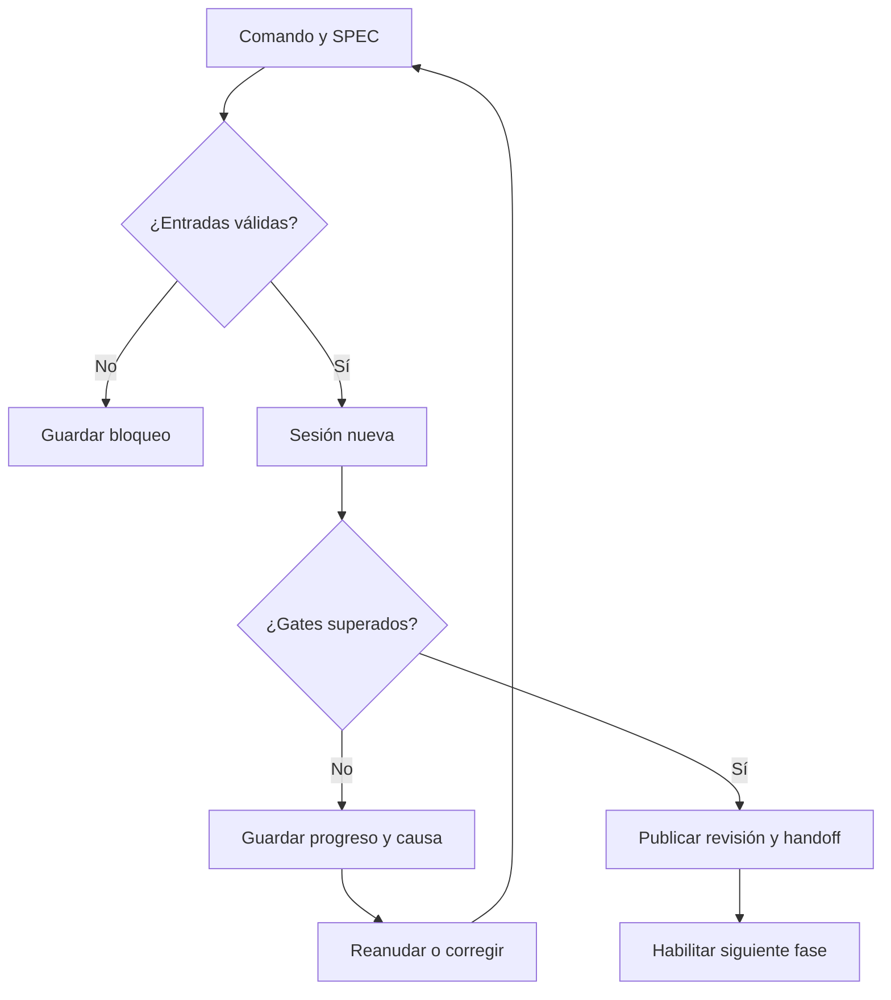

# 🔄 02. Comandos y ciclo de desarrollo

> 📝 **Estado:** propuesta de diseño · 🎨 **Perfil visual:** `markdown-mermaid@1.0.0`

**🧭 En este documento**

- [Vista general](#vista-general)
- [1. Interfaz de usuario](#interfaz-de-usuario)
- [2. Contrato común de ejecución](#contrato-comun-de-ejecucion)
- [3. /super-init](#super-init)
- [4. /super-new SPEC-001](#super-new-spec-001)
- [5. /super-requeriments SPEC-001](#super-requeriments-spec-001)
- [6. /super-design SPEC-001](#super-design-spec-001)
- [7. /super-task SPEC-001](#super-task-spec-001)
- [8. /super-develop SPEC-001](#super-develop-spec-001)
- [9. /super-review SPEC-001](#super-review-spec-001)
- [10. /super-close SPEC-001](#super-close-spec-001)
- [11. Repeticiones y cambios de alcance](#repeticiones-y-cambios-de-alcance)

## 🧭 Vista general

Una fase valida entradas, produce resultados y solo avanza tras superar sus controles.

## 📝 1. Interfaz de usuario

La CLI estable será `super <comando> [SPEC]`. La consola propia `super shell` traducirá `/super-*` a esa CLI sin pedir al modelo que interprete el nombre. Los adaptadores para chats serán accesos cómodos al mismo motor.

| Interfaz solicitada | CLI canónica | Entrada principal | Estado de éxito |
|---|---|---|---|
| `/super-init` | `super init` | Solución y perfil; una sola vez | Solución inicializada |
| `/super-new SPEC-001` | `super new SPEC-001` | Fuente resuelta | `ANALYZED` |
| `/super-requeriments SPEC-001` | `super requirements SPEC-001` | Análisis y código | `REQUIREMENTS_READY` |
| `/super-design SPEC-001` | `super design SPEC-001` | Requisitos aceptados | `DESIGN_READY` |
| `/super-task SPEC-001` | `super task SPEC-001` | Diseño aceptado | `TASKS_READY` |
| `/super-develop SPEC-001` | `super develop SPEC-001` | Tareas y repositorio aislado | `IMPLEMENTED` |
| `/super-review SPEC-001` | `super review SPEC-001` | Diff, requisitos y evidencia | `REVIEW_PASSED` |
| `/super-close SPEC-001` | `super close SPEC-001` | PR, documentación y evidencia | `CLOSED` o espera explícita |

`super-requirements` y `super-requeriments` serán aliases equivalentes. Los ejemplos futuros con `--source`, `--resume`, `--replan`, `--refresh-source`, `--provider` y `--prepare` describen opciones a implementar, no opciones existentes hoy.

Operaciones auxiliares: `super status SPEC-001`, `super doctor`, `super validate SPEC-001`, `super answer SPEC-001 Q-001 --file respuesta.md` y `super sync SPEC-001`. Muestran o mantienen el proceso; no añaden otra vía para editar código.

## 🧩 2. Contrato común de ejecución

Antes de cada comando, el motor resuelve el repositorio externo de conocimiento y la solución/repo de código asociados, y comprueba sus identidades, estado previo, permisos, versiones, integridad de artefactos y cambios en los inputs. Adquiere un bloqueo, crea un `run_id`, registra el estado `RUNNING` y construye un paquete de contexto. El proveedor empieza una sesión nueva sin reanudar la conversación anterior.

Al terminar, Go valida la respuesta, ejecuta los controles de la fase y publica una revisión inmutable de sus artefactos. Registra evidencias, actualiza la proyección del estado y libera el bloqueo. Un fallo no convierte archivos parciales en un resultado aceptado.

Todos los `.md` de cada fase se renderizan con el [perfil visual común](12-estandar-visual-markdown.md). El gate documental comprueba estructura, iconos, enlaces y diagramas Mermaid aplicables antes de aceptar la revisión. Ninguna fase puede publicar Markdown generado al margen de este contrato.

Cada fase entrega `handoff.md` con decisiones, preguntas, evidencia, trabajo pendiente y siguiente comando permitido. El traspaso resume; el manifiesto referencia los documentos completos.

Estados de ejecución: `RUNNING`, `SUCCEEDED`, `BLOCKED_INPUT`, `FAILED`, `INTERRUPTED`. Son distintos del estado de la SPEC. Un requisito cambiado puede marcar fases `STALE` aunque su última ejecución hubiera terminado correctamente.

Los estados de SPEC recorren `ANALYZED → REQUIREMENTS_READY → DESIGN_READY → TASKS_READY → DEVELOPING → IMPLEMENTED → REVIEW_PASSED → CLOSED`, con los estados de espera/retrabajo definidos más abajo. El diario conserva además `last_valid_phase`: una interrupción durante develop no borra que task terminó correctamente. Antes de new no existe una SPEC; init prepara el repositorio.

## ⚙️ 3. /super-init

**Objetivo:** inicializar una única vez la solución y preparar su conocimiento base. Es el alta de la solución, previa al ciclo de SPEC. Las siguientes features empiezan en `/super-new` y reutilizan el conocimiento mantenido por `/super-close`.

1. Detectar raíz Git, soluciones, proyectos, lenguajes, herramientas, instrucciones existentes y archivos de configuración. No confundir `_Develapi` con un único repositorio.
2. Resolver el repositorio externo de conocimiento configurado; crear su estructura o reutilizarla sin escribir en el código analizado. Resolver un `solution_id` estable y comprobar allí su manifiesto. Si está inicializada, terminar sin cambios. Si el alta anterior quedó incompleta, reanudar solo sus pasos pendientes. Crear configuración, perfiles y estructura documental conservando documentos preexistentes.
3. Capturar inventario de proyectos y dependencias; proponer baseline de convenciones con evidencia por archivo y símbolo.
4. Construir el grafo, guardar versión del indexador y huella del snapshot. Las dependencias externas sin fuentes se marcan como tales.
5. Detectar framework de pruebas, herramientas disponibles y comandos de calidad. La ausencia de tests se informa como carencia, nunca como suite aprobada.
6. Publicar `project-map.md`, `standards.md`, `baseline.json`, `graph-manifest.json` y el resumen de diagnóstico.

**Permisos:** escribir documentación, configuración propia, índice y caché exclusivamente en el repositorio externo de conocimiento (runtime/caché ignorados por Git). No cambiar `.cs`, `.csproj`, `.slnx`, CI ni tests del producto. Cualquier incorporación de analizadores o infraestructura de pruebas se planifica como tarea para develop.

**Salida válida:** inventario utilizable y perfil explícito. Grafo parcial permitido con limitaciones visibles; grafo semántico completo no se presume por el simple éxito del parser. Una segunda invocación devuelve `ALREADY_INITIALIZED`, sin llamadas al modelo ni regeneración documental. El mantenimiento incremental pertenece al flujo normal y al cierre de SPEC. El manifiesto de inicialización se comparte en el Git del repositorio de conocimiento: cambiar de usuario o clonar no obliga a inicializar otra vez. Si hay varias soluciones en un repositorio, cada una tiene identidad y manifiesto propios; no se elige una al azar.

## 📝 4. /super-new SPEC-001

**Objetivo:** comprender y normalizar la petición antes de diseñar.

**Precondición:** la solución está inicializada. New carga desde el repositorio externo su documentación, capacidades y ADR integrados, mantenidos por los cierres anteriores, y registra `solution_id` y `knowledge_revision` en los inputs. No vuelve a ejecutar init ni reconstruye el conocimiento base por feature. Si nunca se ha inicializado, indica que falta esa operación única.

Resolución: usar el `source_ref` ya registrado; si no existe, buscar en la ruta local configurada y en el mapeo Jira. Si ambas fuentes existen y son distintas, exigir `--source local:...` o `--source jira:...`. No elegir según cuál responda primero. `SPEC-001` es el ID interno; puede mapear a `DEV-123` sin asumir que sea una clave Jira real.

Pasos: capturar fuente con fecha, ID y hash; extraer objetivo, actores, alcance, exclusiones y términos; buscar áreas candidatas de código; separar hechos, supuestos y preguntas. Producir `source.md`, `brief.md`, `analysis.md`, `questions.md`, `traceability.json` y `handoff.md`.

La fase puede terminar `ANALYZED` con preguntas no críticas. Las ambigüedades que cambien el comportamiento requerido bloquean requirements. Cada respuesta se guarda con autor, fecha y pregunta. No rellenar huecos de negocio como si fueran datos del ticket.

## 📝 5. /super-requeriments SPEC-001

**Objetivo:** convertir la petición en condiciones verificables compatibles con el código actual.

Leer contratos, servicios, entidades, persistencia, validadores y pruebas relacionados. Identificar comportamiento existente, cambios deseados y efectos colaterales. Asignar `REQ-001`, `NFR-001` y `AC-001` estables; no renumerarlos por cambios de orden.

Generar `requirements.md`, `acceptance.feature`, `constraints.md`, `verification-plan.md` y la matriz de trazabilidad. Cada requisito tendrá fuente, prioridad, criterio de aceptación, forma de verificación y referencias al código cuando corresponda. Incluir escenarios negativos y límites pertinentes.

Gherkin expresa resultados observables. No introducir decisiones como «usar Redis» salvo que sean restricciones explícitas. Los requisitos técnicos especifican resultados medibles, por ejemplo cancelación, unicidad bajo concurrencia o compatibilidad del contrato HTTP.

**Gate:** ninguna pregunta crítica pendiente; todos los requisitos cubiertos por escenarios o verificaciones específicas; referencias válidas; perfil y revisión de fuente fijados. El diseño todavía no prueba que el software cumpla nada.

## 🏗️ 6. /super-design SPEC-001

**Objetivo:** proponer una solución realizable y demostrar cobertura prevista.

Generar `design.md`, `impact.md`, `test-plan.md` y ADR cuando haya decisiones relevantes. Definir componentes, secuencias, contratos, errores, transacciones, seguridad, migración de datos si procede, compatibilidad y rollback. Justificar alternativas con el estándar del repo y el grafo.

Una CRUD pequeña que sigue un patrón aceptado puede referenciar un ADR existente; no necesita un ADR ceremonial nuevo. Una dependencia, frontera de servicio, política de consistencia o cambio de contrato sí requiere decisión explícita.

**Gate:** cada REQ/NFR enlaza con una parte del diseño y una verificación futura. Se comprueban ciclos de dependencias y referencias. Los ADR bloqueantes pasan de `proposed` a `accepted` según la política de responsables; la herramienta no se atribuye aprobación humana.

## 📋 7. /super-task SPEC-001

**Objetivo:** preparar unidades técnicas ejecutables con contexto suficiente.

Crear un `.md` por tarea, `tasks/index.md` y `tasks.json`. Cada tarea incluye requisito, dependencias, rutas permitidas, símbolos existentes o propuestos, secuencia RED/GREEN/REFACTOR, comandos exactos de prueba, evidencia esperada y criterio de terminación.

Las tareas serán cortes de comportamiento pequeños; no dividir todo en «escribir todos los tests» y después «escribir todo el código». Los cambios habilitadores —crear proyecto de tests, por ejemplo— se identifican y justifican. No se inventa un ciclo RED de negocio para una tarea puramente documental.

**Gate:** DAG sin ciclos, ninguna tarea huérfana, rutas y símbolos comprobados, estimación de contexto razonable, todos los requisitos cubiertos. Nombres sugeridos: `TASK-001-test-harness.md`, `TASK-002-validator-behavior.md`. El manifiesto controla orden y estado.

## 📝 8. /super-develop SPEC-001

**Objetivo:** implementar las tareas en TDD. Es el único comando que escribe código, pruebas, migraciones, proyectos, dependencias o configuración de ejecución del producto.

1. Preparar una rama y checkout aislados desde `develop`; no arrastrar cambios ajenos del usuario. Registrar base, HEAD y tarea activa. En el MVP, una SPEC tiene una rama de implementación en un repo de código y una rama documental independiente en el repo de conocimiento. Tareas, evidencia y checkpoints se escriben en este último, nunca dentro del checkout de código.
2. Ejecutar baseline. Si el proyecto no compila por credenciales o dependencias, guardar el fallo como problema de entorno.
3. Para cada tarea de comportamiento: crear test, ejecutarlo y capturar fallo esperado (**RED**); implementar lo mínimo (**GREEN**); refactorizar y repetir pruebas pertinentes (**REFACTOR**).
4. Ejecutar el comando desde un runner supervisado. Guardar exit code, log, resultados del runner, hashes de árboles antes y después y razón del fallo RED.
5. Validar diff contra el alcance y el perfil; registrar checkpoint por tarea y actualizar grafo incremental.
6. Al finalizar, ejecutar la suite de verificación acordada y exportar `implementation.md`, `tdd-evidence.json` y `handoff.md`.

Un error de red, restore o sintaxis no demuestra RED del comportamiento. Puede haber compilación roja al diseñar una API nueva, pero debe identificarse como tal y llegar después a una aserción de comportamiento verificable. No aceptar un test que ya estaba verde como evidencia de regresión sin justificar un caso de caracterización.

`--resume` retoma desde el último checkpoint comprobado, con sesión nueva. Si el árbol no coincide, reconciliarlo y repetir los controles afectados; no volver a aplicar un patch ya presente. Los arreglos de review vuelven a este comando y producen nuevas evidencias.

## 🔍 9. /super-review SPEC-001

**Objetivo:** evaluar código y entrega, y crear o actualizar una PR hacia `develop`.

Primero ejecuta controles locales: alcance, formato en modo verificación, build, tests, trazabilidad, compatibilidad, dependencias, riesgos y evidencia TDD. Un revisor de IA en sesión separada inspecciona diff y fuentes con acceso de lectura. Sus conclusiones se contrastan con evidencia; no se toma «looks good» como prueba.

Después crea o reutiliza la PR de código, enlazando la SPEC mediante el repo/commit de conocimiento y no una ruta local, mediante clave `(repo, head_branch, base_branch)`. Verifica título, descripción, SPEC, ticket, commits, archivos, rama base exacta `develop`, estado draft, revisores y checks. Lee de nuevo la PR remota: no basta con confiar en el cuerpo que se envió.

Resultados posibles:

| Resultado | Efecto |
|---|---|
| Defectos bloqueantes | `CHANGES_REQUESTED`; tareas de corrección para develop; PR draft si se crea |
| Checks todavía ejecutándose | `AWAITING_CHECKS`; guardar PR y reintentar de forma idempotente |
| Falta revisión requerida | `AWAITING_APPROVAL`; no suplantar al responsable |
| Gates completos y SHA coincidente | `REVIEW_PASSED` |
| Error remoto | Preservar revisión local y registrar sincronización pendiente |

Los hallazgos tienen severidad, requisito afectado, ruta, símbolo/línea y explicación. Review no arregla tests, no reformatea archivos ni hace merge. Tampoco el bot autor puede considerarse por sí mismo la aprobación independiente exigida por las reglas del repositorio. [API de revisiones de GitHub](https://docs.github.com/en/rest/pulls/reviews).

## 🔄 10. /super-close SPEC-001

**Objetivo:** verificar la integración del código y actualizar el conocimiento de la solución en su repositorio externo, sin escribir documentación de Superharness dentro del producto.

Cada cierre mantiene análisis vigente, contratos, capacidades, ADR e índice de SPEC, y actualiza el grafo. Publica una `knowledge_revision` que enlaza el commit de conocimiento con el commit de código integrado. La próxima feature comienza en new y carga esa revisión. No se repite init.

1. Consultar la PR de código hacia `develop` y sus revisiones/checks. Si sigue abierta, guardar `AWAITING_MERGE`; opcionalmente `--prepare` prepara el cambio documental en una rama del repositorio de conocimiento, marcado como propuesto.
2. Tras el merge, capturar el commit integrado y comprobar build, tests y gates exigidos sobre ese snapshot mediante CI o runner aislado. La evidencia del head anterior no acredita por sí sola un merge/rebase distinto. Si aparece un defecto, usar `REOPEN_REQUIRED` y devolver la corrección a develop.
3. Actualizar exclusivamente el repositorio de conocimiento: documentación general, contratos, ADR, SPEC, trazabilidad y manifiestos. Validar enlaces y correspondencia con el código integrado. El grafo se mantiene como índice derivado externo.
4. Integrar ese cambio en la rama canónica del repo de conocimiento, configurable e independiente de `develop` (propuesta: `main`). Respetar su política Git: PR si existe remoto y se requiere revisión, o commit local si el repo complementario es local. Hasta completar la integración/publicación configurada, conservar `DOCS_PENDING`.
5. Registrar el par de commits verificados, la revisión de SPEC y los recibos. Sincronizar Jira según política y marcar `CLOSED` solo tras confirmar todos los requisitos de cierre; si falla la sincronización, usar `SYNC_PENDING`.

La documentación en otro repositorio no cambia el HEAD de la PR de código y no exige repetir su review solo por ese motivo. Sí se revisa el cambio documental según su propia política. Si se cambian requisitos/diseño aceptados, o cambia código, se invalidan las comprobaciones dependientes: close no puede modificar requisitos para justificar una implementación distinta.

Un cierre prepara y reintenta acciones idempotentes; no existe una transacción atómica entre ambos repositorios y Jira. Si el código ya está integrado pero falta documentación, conservar el avance y reanudar la publicación documental, sin repetir el merge ni declarar éxito parcial como CLOSED. Las ramas propuestas no se presentan a la siguiente feature como conocimiento integrado.

El manifiesto documental referencia el commit de código; el commit que contiene ese manifiesto identifica la revisión de conocimiento. El diario/recibo externo guarda ambos hashes después de publicar, evitando intentar incluir el hash de un commit dentro de sí mismo. El merge de código sigue el flujo autorizado del equipo; close no lo autoriza automáticamente.

## 🔄 11. Repeticiones y cambios de alcance

Mismos inputs y versión: devolver el resultado válido previo; `--rerun` permite repetir la evaluación dejando otro run. `--refresh-source` trae una nueva revisión del ticket y muestra diferencias. Cambiar requirements invalida design, task, develop y review afectados; cambiar código invalida review; cambiar solo metadatos externos no fuerza una implementación nueva.

Nunca sobreescribir un requisito aceptado porque el agente encontró una solución más fácil. Un cambio necesita revisión de SPEC, impacto y replanificación. Las aprobaciones quedan vinculadas al hash de los artefactos aprobados.
