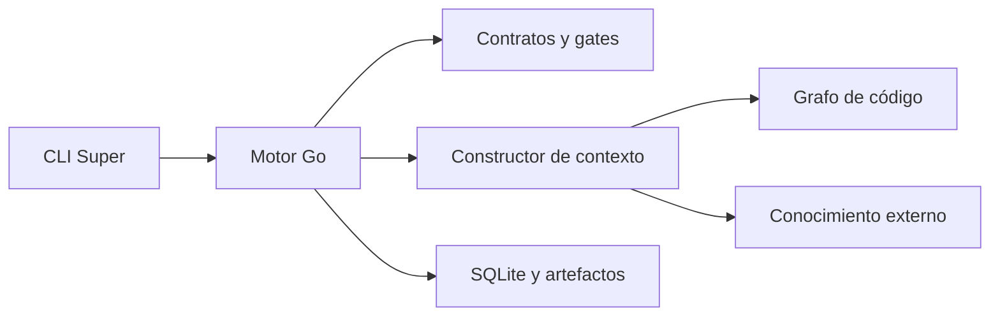
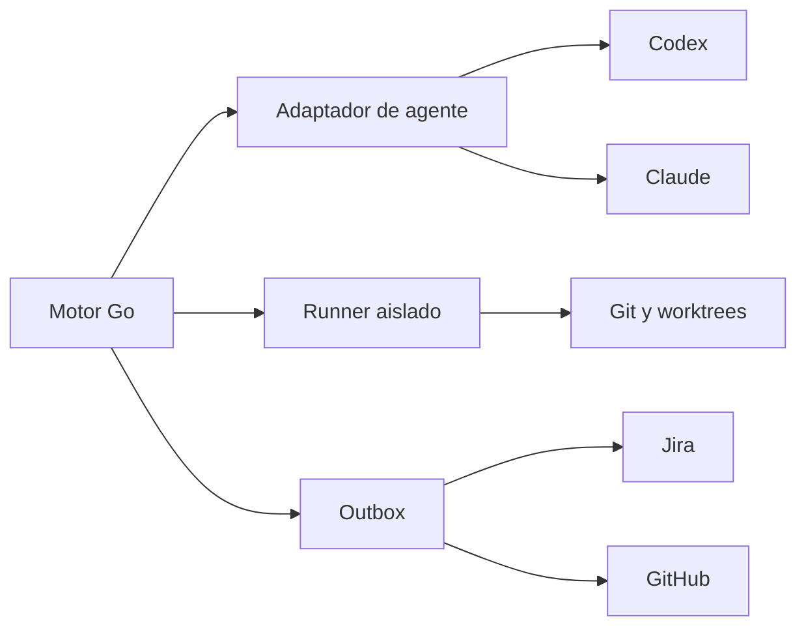

# 🏗️ 03. Arquitectura Go, estado y recuperación

> 📝 **Estado:** propuesta de diseño · 🎨 **Perfil visual:** `markdown-mermaid@1.0.0`

**🧭 En este documento**

- [1. Componentes](#componentes)
- [2. Interfaces propuestas](#interfaces-propuestas)
- [3. Quién es la fuente de verdad](#quien-es-la-fuente-de-verdad)
- [4. Almacenamiento](#almacenamiento)
- [5. Persistencia sin transacciones ficticias](#persistencia-sin-transacciones-ficticias)
- [6. Contexto limpio de verdad](#contexto-limpio-de-verdad)
- [7. Invalidación y concurrencia](#invalidacion-y-concurrencia)
- [8. Garantía de escritura exclusiva](#garantia-de-escritura-exclusiva)
- [9. Casos de recuperación obligatorios](#casos-de-recuperacion-obligatorios)
- [10. Inicialización única y conocimiento por solución](#inicializacion-unica-y-conocimiento-por-solucion)

<a id="componentes"></a>

## 🏗️ 1. Componentes



El núcleo valida las fases y recupera conocimiento sin depender del proveedor.



Los agentes proponen cambios, el runner produce evidencia y el outbox reconcilia operaciones remotas.

El núcleo de dominio solo conoce SPEC, fases, tareas, evidencias y transiciones. No conoce flags concretos de Codex, JSON de Jira ni llamadas de GitHub. Esa separación facilita probarlo sin gastar tokens ni conectar cuentas.

Estructura propuesta:

```text
cmd/super/main.go
internal/
  cli/                    # argumentos, consola, códigos de salida
  domain/                 # Spec, Task, Run, Evidence, Finding
  workflow/               # transiciones y ejecución de fases
  contracts/              # JSON Schema y validadores semánticos
  artifacts/              # manifiestos, hashes, publicación atómica
  documentation/          # renderizador Markdown, iconos y diagramas
  docvalidation/          # enlaces, estructura y validación Mermaid
  state/                  # SQLite, locks, journal, migraciones
  context/                # selección y presupuesto de contexto
  graph/                  # interfaz y consultas normalizadas
  providers/codex/        # procesos, eventos y capacidades
  providers/claude/
  integrations/jira/
  integrations/github/
  git/                    # snapshots, ramas, worktrees
  runner/                 # procesos, permisos, logs, resultados
  policy/                 # scopes de escritura y gates
  telemetry/              # costes, duración y métricas
assets/
  schemas/
  templates/
  prompts/
  profiles/dotnet-develapi/
tests/
  fixtures/
  integration/
  evals/
```

Preferir biblioteca estándar para procesos, HTTP, JSON y hashing; seleccionar bibliotecas de CLI, SQLite y JSON Schema en una tarea dedicada y fijarlas en `go.mod`/`go.sum`. No se fija aquí una dependencia sin probar distribución Windows/Linux y compatibilidad. El binario será Go; el indexador externo, Codex, Claude y .NET siguen siendo dependencias operativas. «Hecho en Go» no implica que toda la cadena sea un único ejecutable sin runtimes.

<a id="interfaces-propuestas"></a>

## 📝 2. Interfaces propuestas

Pseudocódigo Go: los tipos de dominio se completarán durante implementación.

```go
type AgentProvider interface {
    Capabilities(ctx context.Context) (Capabilities, error)
    Run(ctx context.Context, request RunRequest, sink EventSink) (RunResult, error)
}

type CodeGraph interface {
    Index(ctx context.Context, snapshot Snapshot) (GraphManifest, error)
    Query(ctx context.Context, query GraphQuery) (GraphResult, error)
    Resolve(ctx context.Context, ref CodeReference) (ResolvedReference, error)
}

type IssueTracker interface {
    Read(ctx context.Context, ref SourceRef) (SourceSnapshot, error)
    Apply(ctx context.Context, operation RemoteOperation) (RemoteReceipt, error)
}

type PullRequestHost interface {
    Ensure(ctx context.Context, request PullRequestRequest) (PullRequest, error)
    Inspect(ctx context.Context, id PullRequestID) (PullRequestStatus, error)
}
```

`RunRequest` contiene: fase, SPEC/revisión, modelo fijado, contexto renderizado, schema de salida, directorio aislado, capacidades permitidas, límites y rutas de staging. `RunResult` contiene: versión real del proveedor, ID de sesión, artefactos propuestos, preguntas, uso si está disponible y estado de terminación. Un exit code 0 no sustituye la validación de la respuesta.

La cancelación necesita terminar el árbol de procesos, no solo el proceso padre: estrategia específica para Windows y Unix, timeout, drenaje de stdout/stderr y registro de interrupción. Usar argumentos separados con `exec.CommandContext`; no construir comandos shell concatenando texto del ticket.

<a id="quien-es-la-fuente-de-verdad"></a>

## 🔍 3. Quién es la fuente de verdad

| Información | Fuente de verdad | Copias/derivados |
|---|---|---|
| Código integrado | Git remoto y commit verificado | Checkout y grafo |
| Requisitos y decisiones aceptadas | Repo externo de conocimiento: artefactos y manifiesto de revisión | Paquete de contexto |
| Ticket en el momento del análisis | Snapshot de fuente con hash | `source.md` normalizado |
| Estado de ejecución y operaciones pendientes | Diario transaccional SQLite | `state.json`, consola y handoff |
| Estado remoto de PR/Jira | Consulta al servicio | Recibos locales con fecha |
| Relaciones de código | Código/compilación del snapshot | Base de grafo reconstruible |
| Texto generado de requisitos | JSON aceptado | Markdown renderizado |

Un renderizador central aplica `markdown-mermaid@1.0.0` a todos los `.md` del flujo. El agente propone contenido y relaciones; Go determina la plantilla, los iconos, las secciones y la emisión de diagramas. El perfil visual y la versión del validador Mermaid forman parte del manifiesto de herramientas. La validación y los renders temporales se guardan en el runtime externo, sin contaminar el código.

Los Markdown que son vistas generadas llevan esa indicación. Los documentos editables, como la fuente y respuestas humanas, tienen un proceso de importación: parsear, validar y crear una revisión. No se mantienen JSON y Markdown editables de forma independiente sin reconciliarlos.

SQLite no se versiona ni se comparte en una unidad de red entre desarrolladores. Para pasar trabajo a otra máquina se exporta un bundle con manifiestos, estado, evidencias relevantes y hashes. El receptor verifica el bundle y el Git correspondiente antes de reconstruir su diario local. Un clone con solo Markdown puede mostrar planificación; no puede certificar tests que no están presentes o enlazados a una evidencia accesible de CI.

<a id="almacenamiento"></a>

## 📁 4. Almacenamiento

Todo lo siguiente reside en el repositorio externo de conocimiento, por ejemplo `F:\Proyectos\_Develapi\develapi-superharness`. No se crean estos directorios dentro de las soluciones analizadas.

```text
develapi-superharness/
  .git/
  .gitignore                   # solo para este repo complementario
  .super/
    config.yaml                # asociación a repos y soluciones, sin secretos
    solutions/<solution-id>.json  # manifiesto de init único
    toolchain.lock.json
    runtime/                   # ignorado por Git
      state.db
      runs/<run-id>/            # contexto, eventos, staging y evidencias
    cache/graph/               # ignorado; separado por repo/snapshot
  .baseline/<solution-id>/      # análisis inicial conservado
  .project/<solution-id>/       # documentación general vigente
  .specs/SPEC-001/              # artefactos de cada SPEC
```

Los metadatos de repositorio incluyen IDs estables, solución y rutas relativas al repo de conocimiento; las rutas absolutas de cada equipo son overrides locales ignorados. Las SPEC declaran su solución y repositorio de código. Un repo complementario puede organizar todo DevelApi sin convertirlo en un único repo de código.

No guardar secretos ni logs sensibles en Git. El runtime y la caché son locales e ignorados; resúmenes y manifiestos de evidencia aptos para compartir sí se versionan aquí. No copiar el árbol de código dentro del conocimiento: usar referencias a repo, commit, ruta y símbolo.

Tablas mínimas: `solutions`, `specs`, `spec_revisions`, `phase_runs`, `task_runs`, `artifacts`, `evidence`, `approvals`, `events`, `locks`, `outbox`, `remote_receipts`. Identidad de SPEC: `(knowledge_repo_id, spec_id)`; `solution_id` y `code_repo_id` son referencias explícitas. Unicidad también para run, clave de idempotencia y revisión del agregado.

<a id="persistencia-sin-transacciones-ficticias"></a>

## 📝 5. Persistencia sin transacciones ficticias

Un commit SQLite y un rename de archivos no forman una única transacción. Protocolo propuesto:

1. Crear directorio de run y escribir resultados en staging, sin sustituir los aceptados.
2. Verificar schemas, hashes, referencias, scopes y gates.
3. Registrar en SQLite una publicación `PREPARED` con lista y hashes de todos los archivos.
4. Publicar un directorio inmutable `revisions/<revision-id>/` mediante rename en el mismo volumen. Verificar la estrategia en Windows; evitar sustituir archivos que otra herramienta tiene abiertos.
5. Marcar `COMMITTED` y actualizar puntero a revisión actual en SQLite.
6. Regenerar vistas legibles y `state.json` por escritura temporal y reemplazo. Son reconstruibles.

Al arrancar, buscar publicaciones preparadas. Si los archivos completos coinciden, terminar el commit; si no, mantener la última revisión válida y registrar recuperación. Nunca avanzar el estado solo porque un `.md` exista.

Para operaciones remotas se usa outbox: registrar intención, efectuar operación idempotente, guardar recibo y reconciliar. Si GitHub creó la PR pero la respuesta se perdió, buscarla antes de reintentar. No prometer una transacción distribuida entre el Git de código, el Git de conocimiento, SQLite, Jira y GitHub. Un cierre conserva sus pasos confirmados y reintenta solo los pendientes, con commits y ramas diferenciados.

<a id="contexto-limpio-de-verdad"></a>

## 🔄 6. Contexto limpio de verdad

Cada invocación hace lo siguiente:

```text
validar estado → congelar inputs → recuperar referencias → construir context.md
→ lanzar proceso/sesión nueva → validar output → guardar handoff y evidencias
```

No usar `resume`, `continue` ni un ID de sesión anterior para enlazar fases. Un `/clear` visual dentro de una aplicación no prueba aislamiento del ejecutor. La UI puede conservar mensajes; la garantía se aplica al proceso que realiza la fase. Los comandos de chat solo despachan parámetros y presentan el resultado.

El paquete contiene reglas aplicables, objetivo de fase, artefactos aceptados, preguntas resueltas, decisiones relevantes, referencias verificadas y evidencia resumida. No contiene el historial de razonamiento del modelo. `handoff.md` guarda hechos y decisiones, no razonamiento privado.

Las instrucciones de repositorio deben seguir aplicándose. Para reproducibilidad se registran y fijan; no se eluden políticas organizativas para conseguir una configuración idéntica. Cambios de configuración personal no registrados invalidan la etiqueta de ejecución reproducible.

<a id="invalidacion-y-concurrencia"></a>

## 🧪 7. Invalidación y concurrencia

Cada artefacto declara `inputs[]` con hash y versión. El motor mantiene un DAG de dependencias. Un cambio de requisito invalida descendientes; un cambio de estilo invalida comprobaciones de estilo; una actualización del grafo obliga a revalidar referencias afectadas, no necesariamente a reescribir toda la SPEC.

El bloqueo local de SPEC se toma por `(knowledge_repo_id, SPEC)` y el escritor de código por worktree. Contiene propietario, run, heartbeat y vencimiento; recuperar un lock vencido requiere comprobar que el proceso anterior no sigue activo. Actualizaciones de estado usan compare-and-swap sobre revisión.

Dos máquinas no quedan coordinadas por SQLite local. MVP: una rama/SPEC tiene un propietario y se rechazan pushes no fast-forward o divergencias. Evolución: coordinador remoto con leases y operaciones condicionales. Nunca usar force-push automático para resolver concurrencia.

<a id="garantia-de-escritura-exclusiva"></a>

## 📝 8. Garantía de escritura exclusiva

Un prompt que diga «no edites» no es un control suficiente. Requirements, design y task trabajan con snapshot de código de solo lectura; el modelo devuelve JSON y el orquestador publica los documentos. Review ejecuta tests en checkout desechable con runner controlado: los tests pueden generar `bin/obj` y salidas temporales, pero ningún cambio del producto se publica.

Develop trabaja en checkout dedicado con rutas autorizadas. Init y close disponen solo de escritura documental y de configuración propia en el repositorio externo; el código permanece de solo lectura. La salida de cada proceso y su staging apuntan al repo complementario, aunque su directorio de lectura sea un checkout de código. Denegar escapes de ruta, symlinks/junctions fuera del scope y acceso de escritura a credenciales, remotos o worktrees ajenos. Si el proveedor no permite aplicar la política necesaria en el host, usar aislamiento externo o rechazar el modo; no fingir aislamiento.

Toda fase compara el árbol antes y después, incluyendo archivos no seguidos y archivos de build/configuración. Las evidencias y el runtime quedan fuera del hash del árbol del producto para evitar que escribir un log invalide su propia evidencia. Se guardan por separado `product_tree_hash`, `artifact_manifest_hash` y `full_commit_sha`.

<a id="casos-de-recuperacion-obligatorios"></a>

## 🔄 9. Casos de recuperación obligatorios

| Incidente | Comportamiento |
|---|---|
| Cierre durante RED | Conservar test y logs; revalidar árbol y repetir RED al continuar |
| Límite de contexto | Checkpoint y nuevo proceso con tarea pendiente; no truncar requisitos esenciales |
| Fallo de proveedor | Marcar run fallido; no cambiar de modelo silenciosamente |
| Archivo editado manualmente | Detectar hash distinto e importar como revisión o bloquear |
| PR creada y respuesta perdida | Reconciliar por rama/base/marcador antes de crear otra |
| Jira inaccesible tras merge | `SYNC_PENDING`; no afirmar cierre remoto |
| Evidencias ausentes al clonar | Reejecutar validaciones o recuperar bundle/CI; no confiar en un checkbox |
| Cambio de HEAD tras review | Invalidar aprobación y checks asociados; volver a review |

Las migraciones de schemas y SQLite se versionan y se prueban con copia previa. Un binario antiguo debe rechazar un schema futuro que no entienda.

<a id="inicializacion-unica-y-conocimiento-por-solucion"></a>

## 📝 10. Inicialización única y conocimiento por solución

La identidad de inicialización es `(code_repo_id, solution_id)`, registrada en el repo de conocimiento asociado, no el usuario, la máquina, la SPEC ni el worktree. Guardar en el Git del repositorio externo de conocimiento `.super/solutions/<solution-id>.json` con ruta relativa de la solución, schema, estado de inicialización y manifiesto del baseline. No depender solo de SQLite local para saber si la solución está inicializada.

Init adquiere un lock por solución y publica `INITIALIZED` tras confirmar los artefactos de alta. Una invocación posterior devuelve `ALREADY_INITIALIZED` sin escribir ni invocar al proveedor. Una interrupción durante el alta permite reanudar ese mismo proceso sin crear otro baseline. Migraciones y reparación de caché son mantenimiento, no nuevas inicializaciones.

Cada close publica una revisión del conocimiento integrado con manifiesto documental, commit de integración y SPEC de origen. New carga esa revisión y fija su hash en los inputs. Una SPEC en curso detecta revisiones posteriores y evalúa el impacto antes de actualizar referencias. Conservar revisiones permite reproducir qué información usó cada feature.

El MVP selecciona una solución explícitamente. Si el repo de conocimiento agrupa varias soluciones, separar catálogos por `solution_id` —por ejemplo, `.project/<solution-id>/` dentro de ese repo— y namespaces de caché/estado, manteniendo `spec_id` único en el repo de conocimiento. Los proyectos `.csproj` de una solución no cuentan como soluciones distintas.

Al clonar el repositorio de conocimiento se recuperan manifiestos y documentos compartidos; SQLite y el índice local se reconstruyen sin ejecutar init. Los cierres concurrentes deben reconciliar cambios documentales sobre la última base integrada, evitando borrar el conocimiento aportado por otra SPEC.
