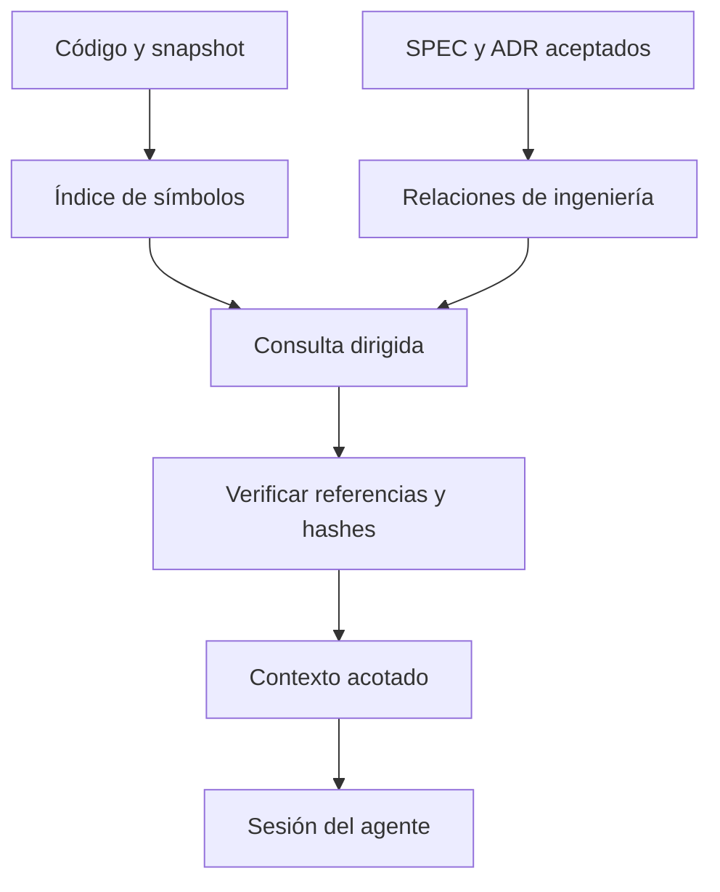

# 🧩 04. Grafo de conocimiento y ahorro de contexto

> 📝 **Estado:** propuesta de diseño · 🎨 **Perfil visual:** `markdown-mermaid@1.0.0`


**🧭 En este documento**

- [Vista general](#vista-general)
- [1. Qué se propone usar](#que-se-propone-usar)
- [2. Grafo de código y grafo de ingeniería](#grafo-de-codigo-y-grafo-de-ingenieria)
- [3. Indexación inicial: una sola vez por solución](#indexacion-inicial-una-sola-vez-por-solucion)
- [4. Referencias directas duraderas](#referencias-directas-duraderas)
- [5. Recuperación de contexto](#recuperacion-de-contexto)
- [6. Presupuestos iniciales](#presupuestos-iniciales)
- [7. Actualización e invalidación](#actualizacion-e-invalidacion)
- [8. Cómo demostrar ahorro](#como-demostrar-ahorro)

<a id="vista-general"></a>

## 🧭 Vista general



Codigo y decisiones alimentan indices separados; una consulta selecciona y verifica referencias antes de formar el contexto.

<a id="que-se-propone-usar"></a>

## 📝 1. Qué se propone usar

«Codegraph» puede referirse a distintos productos. Para concretar el plan, se toma **CodeGraphContext** como candidato inicial y se define un adaptador sustituible. Su documentación declara CLI/MCP, extracción de símbolos y relaciones, soporte C# y una ruta semántica mediante SCIP/scip-dotnet basada en Roslyn. Esa ruta necesita proyectos y restore correcto. No se ha instalado ni evaluado aquí. [Repositorio oficial de CodeGraphContext](https://github.com/CodeGraphContext/CodeGraphContext).

La decisión de adopción depende de una prueba real con DevelApi. En particular, las soluciones inspeccionadas son `.slnx`: no asumir soporte porque la documentación mencione `.sln`. Probar entrada por `.csproj` si hace falta. No convertir soluciones del usuario para sortear una limitación sin una tarea explícita.

Alternativa: helper .NET que use Roslyn y exponga JSON al binario Go. Roslyn permite trabajar con soluciones, proyectos y documentos; el helper es una dependencia externa, no código C# ejecutado mágicamente dentro de Go. [Modelo Workspace de Roslyn](https://learn.microsoft.com/en-us/dotnet/csharp/roslyn-sdk/work-with-workspace).

El índice, sus manifiestos y todo conocimiento generado se almacenan fuera del código, en `develapi-superharness`. La indexación recibe raíces de código explícitas y excluye el repo complementario al recorrer `_Develapi`, para evitar indexar sus propias salidas. El grafo de ingeniería lee esos documentos por un canal separado y con procedencia distinta.

<a id="grafo-de-codigo-y-grafo-de-ingenieria"></a>

## 📝 2. Grafo de código y grafo de ingeniería

Se necesitan dos conjuntos relacionados:

| Conjunto | Nodos | Relaciones |
|---|---|---|
| Código | Repo, Project, File, Symbol, Endpoint, Test, Package | DEFINES, REFERENCES, CALLS, IMPLEMENTS, DEPENDS_ON, TESTS |
| Ingeniería | Spec, Requirement, Scenario, Task, ADR, Review, PR | REQUIRES, SATISFIES, IMPLEMENTED_BY, VERIFIED_BY, DECIDED_BY, SUPERSEDES |

El indexador externo extrae el primero. Super añade el segundo desde manifiestos validados. No se presupone que CodeGraphContext comprenda los IDs de SPEC o ADR de esta propuesta.

Cada nodo o arista tendrá procedencia: repositorio, snapshot, ruta, símbolo, hash y tipo de evidencia. Diferenciar `compiler_resolved`, `syntax_inferred`, `convention_inferred` y `human_declared`. Una relación inferida por IA no se convierte en llamada real confirmada.

<a id="indexacion-inicial-una-sola-vez-por-solucion"></a>

## 📝 3. Indexación inicial: una sola vez por solución

1. Enumerar código relevante desde Git y las inclusiones configuradas; excluir `.git`, `bin`, `obj`, dependencias vendorizadas, secretos, logs y generados salvo necesidad explícita.
2. Identificar proyectos, referencias, paquetes, contratos públicos y convenciones de DI.
3. Ejecutar parser/compilador contra un snapshot conocido. Un restore requiere configuración y credenciales adecuadas; no se intenta resolverlo mostrando secretos.
4. Generar manifest con commit, hash del árbol, archivos indexados, errores, versión y cobertura por tipo de relación.
5. Exportar un mapa pequeño del proyecto. Mantener el grafo grande fuera del contexto del modelo.

En DevelApi hay inyección dinámica (`AddDynamicDependencyInjections("DevelApi.")`), interfaces genéricas y paquetes compartidos. Una llamada a `IInteractorService<TRequest,TResponse>` no identifica por sí sola la implementación de runtime. Añadir reglas de convenciones y, cuando importe, evidencia de composición o pruebas de integración. Reflexión, configuración, consultas LINQ y límites de paquetes pueden impedir un grafo completo.

El código fuente de `develapi-core` no se considera automáticamente la implementación exacta de la versión NuGet consumida por Gateway o Library. Registrar versión de paquete y correspondencia de fuentes verificada; si no existe, mantener el vínculo como no resuelto.

<a id="referencias-directas-duraderas"></a>

## 🔗 4. Referencias directas duraderas

Una referencia para tareas debe tener más que un número de línea:

```json
{
  "repo_id": "develapi-library",
  "snapshot": "<commit-o-hash-del-arbol>",
  "path": "src/DevelApi.Library.UseCases/Book/Create/BookCreateService.cs",
  "symbol": "DevelApi.Library.UseCases.Book.Create.BookCreateService.Execute",
  "signature": "Task<BookCreateResponse> Execute(BookCreateRequest, CancellationToken)",
  "file_sha256": "<calculado>",
  "line_start": 77,
  "line_end": 115,
  "resolution": "verified-source"
}
```

Las líneas anteriores corresponden al archivo leído para este plan; cambiarán si el código cambia. El símbolo y el hash permiten detectar la deriva. Si un símbolo todavía no existe, marcar `proposed_symbol`, no fingir que fue encontrado.

<a id="recuperacion-de-contexto"></a>

## 🔄 5. Recuperación de contexto

Algoritmo propuesto:

1. Convertir entidades, operaciones, rutas y errores de la SPEC en semillas de búsqueda.
2. Buscar por texto exacto e identificadores, luego por términos relacionados.
3. Ampliar uno o dos saltos a interfaces, implementaciones, llamadores, persistencia, tests y ADR relevantes.
4. Ordenar por coincidencia con requisito, proximidad y autoridad; desempatar por ruta/símbolo estable.
5. Leer fragmentos reales y verificar hashes. Incluir contratos completos cuando un recorte pueda cambiar su significado.
6. Construir `context-manifest.json` con incluidos, omitidos, motivo y presupuesto. Permitir ampliación supervisada y registrar cada lectura adicional.

No introducir embeddings en la primera versión salvo que las búsquedas de vocabulario lo justifiquen. La búsqueda semántica es un índice adicional; nunca acredita una relación de tipos o una dependencia.

<a id="presupuestos-iniciales"></a>

## 📝 6. Presupuestos iniciales

Valores orientativos para calibrar, no límites universales de los modelos:

| Fase | Presupuesto inicial de entrada |
|---|---|
| new | 6–12 mil tokens |
| requirements | 12–20 mil |
| design | 16–28 mil |
| task | 12–20 mil |
| develop | 12–24 mil por tarea |
| review | 16–32 mil por conjunto revisado |
| close | 8–16 mil |

Reservar salida y herramientas según la ventana del modelo. Contar tokens con el mecanismo disponible para ese proveedor; si solo hay una estimación, etiquetarla. No omitir un requisito obligatorio para cumplir el presupuesto: dividir la tarea o ampliar de forma registrada.

<a id="actualizacion-e-invalidacion"></a>

## 🧪 7. Actualización e invalidación

Comprobar la vigencia del índice al iniciar cada comando y actualizar incrementalmente solo si cambia el snapshot; durante develop, tras checkpoints que alteren símbolos; al cerrar, actualizar el conocimiento compartido en el repo complementario sobre el commit de código integrado. Este mantenimiento automático no ejecuta `/super-init` de nuevo. Close publica la revisión de conocimiento que consultará la siguiente feature. Comparar por hash, procesar renombrados y borrados, eliminar aristas obsoletas y recalcular dependientes afectados.

Un índice distinto por rama/worktree impide que una SPEC vea como integrado el trabajo incompleto de otra. Reindexar todos los proyectos afectados por cambios de referencias, firmas o paquetes, no solo el archivo modificado.

Si un clon nuevo no dispone de caché local, reconstruir ese índice derivado desde código y manifiestos compartidos sin reinicializar ni regenerar decisiones/documentación. Si falla el grafo, usar `rg`, proyectos y lectura dirigida como modo degradado declarado. La fase puede continuar si logra la evidencia necesaria por otra vía; debe bloquearse cuando no pueda justificar el impacto requerido. Un resumen antiguo no rellena ese vacío.

<a id="como-demostrar-ahorro"></a>

## 📝 8. Cómo demostrar ahorro

Comparar el mismo conjunto de tickets, snapshots, proveedor y perfil con dos estrategias: búsqueda/lectura sin grafo y recuperación con grafo. Medir tokens de entrada/salida, llamadas, tiempo, coste de indexación, reindexación, referencias correctas, requisitos omitidos y éxito de pruebas.

```text
ahorro = 1 - tokens_totales_con_grafo / tokens_totales_sin_grafo
```

Incluir la construcción del índice amortizada sobre el número real de SPEC, y también los tokens de reparaciones. El objetivo provisional es reducir al menos un 30 % de contexto de entrada en el piloto sin empeorar cobertura ni calidad; no es una promesa. Un grafo que cueste más de lo que ahorra o pierda referencias relevantes debe revisarse o desactivarse para ese caso.
