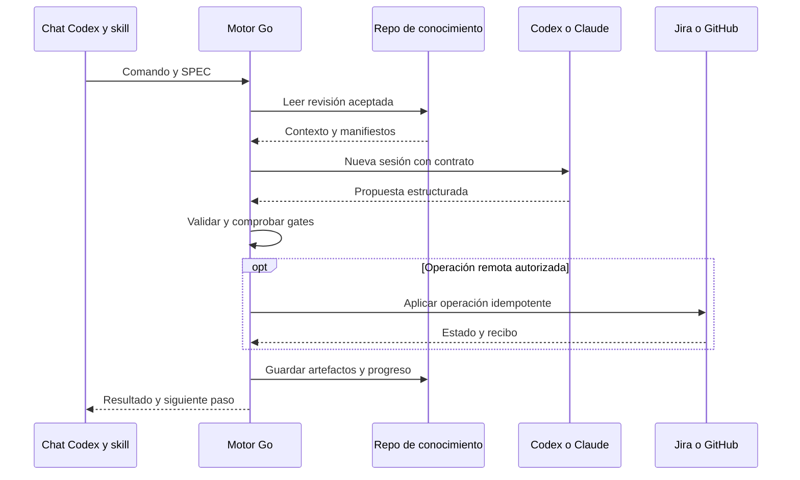

# 🔗 06. Integraciones con agentes, Jira y GitHub

> 📝 **Estado:** propuesta de diseño · 🎨 **Perfil visual:** `markdown-mermaid@1.0.0`


**🧭 En este documento**

- [Vista general](#vista-general)
- [1. Regla general](#regla-general)
- [2. Codex](#codex)
- [3. Claude Code](#claude-code)
- [4. La experiencia /super-* y el clear](#la-experiencia-super-y-el-clear)
- [5. Capacidades y compatibilidad](#capacidades-y-compatibilidad)
- [6. Jira](#jira)
- [7. GitHub](#github)
- [8. Permisos por fase](#permisos-por-fase)
- [9. Robustez operativa](#robustez-operativa)

<a id="vista-general"></a>

## 🧭 Vista general



Go prepara el contexto, ejecuta el agente, valida su propuesta y realiza las acciones remotas autorizadas.

<a id="regla-general"></a>

## 📝 1. Regla general

Las integraciones son adaptadores del motor. El LLM no dispone de credenciales para mutar Jira o GitHub directamente: propone resultados estructurados y Go ejecuta las operaciones permitidas. Así se puede probar idempotencia, auditar acciones y mantener las mismas reglas con Codex y Claude.

El modo inicial de conectores será lectura y simulación de escritura. Al configurar el producto se autorizarán explícitamente las operaciones deseadas —crear PR, actualizar el comentario de progreso, transicionar tickets— y esa política persistirá. No pedir confirmación repetida para cada operación ya autorizada.

El motor mantiene conexiones Git separadas para código y conocimiento. Todos los archivos de análisis, SPEC, prompts renderizados, informes y documentación se escriben en el repositorio complementario. No se instalan wrappers ni configuración de Superharness dentro de los repositorios analizados; se usan la instalación de usuario, el empaquetado de la herramienta o el repositorio de conocimiento.

<a id="codex"></a>

## 🔗 2. Codex

Usar ejecución no interactiva: `codex exec --json` permite consumir eventos y `--output-schema` restringe la respuesta final. `--output-last-message` puede guardarla aparte. El modo de lectura es el predeterminado y `--sandbox workspace-write` habilita escritura donde corresponda. Crear una ejecución nueva por fase; `--ephemeral` controla la conservación de la sesión del proveedor, no sustituye el diario de Super. La autenticación CLI y el uso de API tienen condiciones propias. [Modo no interactivo de Codex](https://learn.chatgpt.com/docs/non-interactive-mode).

Forma orientativa de invocación para una fase documental:

```text
codex exec --json --sandbox read-only --output-schema <schema> -
```

Go envía el prompt por stdin, captura eventos y valida la salida. Para develop selecciona escritura en un checkout aislado. `doctor` comprobará versión, flags, autenticación, modelo y política efectiva. No usar flags antiguos por memoria ni ampliar permisos automáticamente si un comando falla.

El chat de Codex es la entrada principal. Se distribuirán skills explícitas `super-init`, `super-new` y las restantes fases, instaladas en ámbito de usuario o mediante el paquete de la herramienta, fuera del código analizado. La documentación oficial indica que las skills habilitadas aparecen en el menú `/` y también se pueden invocar con `$`. El instalador debe comprobar el nombre exacto `/super-new` en la versión y superficie utilizadas; escribir documentación no lo registra. [Comandos del chat](https://learn.chatgpt.com/docs/reference/slash-commands), [skills de Codex](https://learn.chatgpt.com/docs/build-skills).

<a id="claude-code"></a>

## 🔗 3. Claude Code

El adaptador puede usar `claude -p`, `--output-format json` y `--json-schema`; debe leer el resultado estructurado y los metadatos, no confundirlos con la respuesta textual. También existe salida de eventos. Cada fase comienza sin `--continue` ni `--resume`. [Ejecución programática de Claude Code](https://code.claude.com/docs/en/headless).

Las skills de proyecto en `.claude/skills/<nombre>/SKILL.md` pueden exponerse como slash commands; en este diseño se alojan fuera del código analizado, por ejemplo en el repo de conocimiento. Un wrapper delega en la CLI Super; no reproduce su máquina de estados en el prompt. [Skills de Claude Code](https://code.claude.com/docs/en/skills).

El aislamiento de instrucciones de usuario, herramientas y memoria se comprobará por versión. El modo `--bare` documentado puede ayudar a controlar la carga automática, pero cambia la autenticación y los componentes cargados; no se activará suponiendo que conserva el login de suscripción. El contrato de Super debe funcionar con el modo elegido y probado.

<a id="la-experiencia-super-y-el-clear"></a>

## 📝 4. La experiencia /super-* y el clear

La experiencia solicitada es escribir todos los comandos en esta ventana. La CLI queda como interfaz interna para skills, automatización y pruebas.

| Capa | Responsabilidad |
|---|---|
| `/super-requeriments SPEC-001` en Codex | Seleccionar la skill y transmitir los parámetros explícitos |
| Skill de despacho | Resolver la instalación, invocar Go y presentar resultados persistidos |
| `super requirements SPEC-001` | Validar el contrato, resolver la solución y orquestar la fase |
| Proceso nuevo de Codex o Claude | Ejecutar con contexto reconstruido y permisos de esa fase |

La skill no ejecuta el análisis dentro de la conversación actual ni decide por su cuenta los gates. El chat conserva su historial visible; Go crea una sesión de trabajo nueva por fase y no le envía ese historial. Un `/clear` automático de la interfaz no es una garantía ofrecida: el aislamiento pertenece al ejecutor y se comprueba con pruebas de contexto.

La instalación inicial y el alta única de solución son operaciones distintas. Instalar la integración en otro equipo no repite `/super-init`; recupera la identidad y el conocimiento existente. El [contrato de chat](13-interfaz-codex-y-despacho.md) concreta rutas, aliases, resultados y errores.

<a id="capacidades-y-compatibilidad"></a>

## 📝 5. Capacidades y compatibilidad

`doctor` generará un manifiesto con versión de CLI, autenticación disponible, modelos accesibles, schemas soportados, eventos, herramientas, límites, cancelación y sandbox. La interfaz común se limita a capacidades probadas; un proveedor que no pueda aplicar una política de fase debe rechazarla.

Guardar `requested_model` y `resolved_model` si se puede conocer. No cambiar de modelo al agotar cuota sin registrarlo. Un fallback requiere una opción explícita de configuración y un run nuevo. Las pruebas de aceptación comparan comportamiento y contratos; una sesión Claude no debe intentar interpretar el formato interno de sesión de Codex.

<a id="jira"></a>

## 🔗 6. Jira

Se asume Jira Cloud para el primer adaptador. Jira Data Center necesita configuración y validación específicas. No se necesita automatizar el navegador ni «leer el panel» visualmente: integrar incidencias, campos y estados mediante API.

Jira Cloud REST v3 utiliza Atlassian Document Format en campos como descripción y comentarios. El importador conservará el original y una normalización legible. La documentación distingue OAuth 2.0 para integraciones y autenticación apropiada para scripts personales. [REST API v3 de Jira](https://developer.atlassian.com/cloud/jira/platform/rest/v3/intro/).

Contrato propuesto:

| Operación | Momento | Control |
|---|---|---|
| Leer ticket y campos configurados | new/refresh | Snapshot, ID, fecha y hash |
| Consultar estados y transiciones | Configuración/sync | IDs descubiertos; no nombres universales |
| Actualizar comentario propio de progreso | Fases confirmadas | Un comentario con marcador estable, sin duplicados |
| Enlazar SPEC/PR | review | Guardar IDs y URL verificados |
| Transicionar a trabajo/revisión | Según política | Verificar transición permitida y estado actual |
| Transicionar a terminado | close final | Merge, docs y verificación confirmados |

`jira.fields.acceptance_criteria` será un mapeo configurable: no asumir un `customfield_*` universal. Persistir campos usados, adjuntos admitidos y enlaces; limitar tamaño y no descargar URLs arbitrarias incluidas en el ticket.

Si cambia el ticket tras requirements, mostrar diff y crear revisión explícita. No reemplazar requisitos aceptados durante develop. Si la edición local y Jira divergen, pedir una resolución persistida; no aplicar «última escritura gana» a ciegas.

<a id="github"></a>

## 🔗 7. GitHub

MVP: repositorio Git existente y acceso autenticado; API REST para PR o un adaptador `gh` probado. Para uso en equipo, evaluar GitHub App con permisos ajustados y tokens de instalación. El adaptador no registra secretos en comandos ni artefactos.

La API de PR permite gestionar base, head, título, cuerpo y modo draft. Para la PR de código, Super fijará `base=develop`, verificará que la rama exista y leerá el recurso tras crearlo. [Pull requests en GitHub REST](https://docs.github.com/en/rest/pulls/pulls).

Contenido de PR generado desde manifiestos:

```markdown
# 📝 SPEC-001: <resultado de la entrega>

## 📝 Problema y comportamiento resultante
<Qué cambia para el usuario y por qué>

## 🧩 Trazabilidad
SPEC: <enlace al repo de conocimiento fijado a commit y ruta> · Jira: <enlace verificado>
Requisitos: REQ-001, REQ-002 · ADR: ADR-001 o «no requiere nuevo ADR»

## 🧪 Validación
<Comandos, resultados, referencia de evidencia y commit evaluado>

## ⚠️ Riesgos y operación
<Migración, compatibilidad, rollback y limitaciones reales>
```

La revisión remota necesita checks del commit correcto, reglas de rama, aprobaciones válidas y ausencia de conflictos. `unknown` o un check aún pendiente no equivalen a verde. Guardar `reviewed_head_sha`, `base_sha`, `checks_sha` y `merged_commit_sha`; distinguir squash/rebase/merge y verificar la relación resultante por API/Git, sin exigir igualdad entre head y commit de merge.

El orquestador puede publicar hallazgos como comentario/check si está autorizado, pero no convierte su propia evaluación en aprobación humana. Tampoco debe crear un comentario nuevo por cada consulta de estado sin cambios.

Para documentación, usar el repo de conocimiento y su rama canónica propia (propuesta: `main`). No reutilizar por error el remoto, número de PR o rama del producto. Si el repo complementario es solo local, registrar su commit y dejar la referencia documental como local: no inventar enlaces GitHub accesibles al revisor. El modo de colaboración remota exige publicar el conocimiento en un remoto configurado con acceso adecuado.

<a id="permisos-por-fase"></a>

## 📝 8. Permisos por fase

| Fase | Código | Documentación | Jira | GitHub |
|---|---|---|---|---|
| init | Lectura | Perfil/inventario | Lectura opcional | Diagnóstico opcional |
| new | Lectura | Análisis | Leer fuente | Lectura opcional |
| requirements/design/task | Lectura | Artefactos de fase | Progreso si configurado | Lectura opcional |
| develop | Escritura aislada | Evidencia | Progreso si configurado | Push de rama de SPEC si configurado |
| review | Lectura; runner aislado | Informe | Enlace/progreso | Crear/actualizar PR, comprobar checks |
| close | Lectura | Documentación de proyecto | Transición final configurada | Consultar integración; PR documental si necesaria |

La columna Documentación siempre apunta al repo externo. El orquestador puede hacer allí commits documentales y push sin modificar el código ni el HEAD de la PR del producto. Los cambios de configuración que afectan build/runtime/CI cuentan como código y solo se preparan en develop.

<a id="robustez-operativa"></a>

## 📝 9. Robustez operativa

Timeouts, reintentos con backoff y respeto de límites del servicio. Reintentar lecturas; antes de repetir escrituras, reconciliar por identificador o marcador. No asumir un header de idempotencia que el endpoint no documente.

Guardar credenciales en el almacén del sistema o gestor de secretos; configuración solo con referencias. Si se añaden webhooks, validar firma, deduplicar entregas, manejar orden distinto y consultar estado actual antes de transicionar. En el MVP bastan consultas al ejecutar cada comando; no hace falta un servicio siempre encendido.

No se han probado cuentas, permisos, protecciones de rama ni el workflow real de tu Jira. La primera configuración debe descubrirlos y producir un diagnóstico reproducible.
