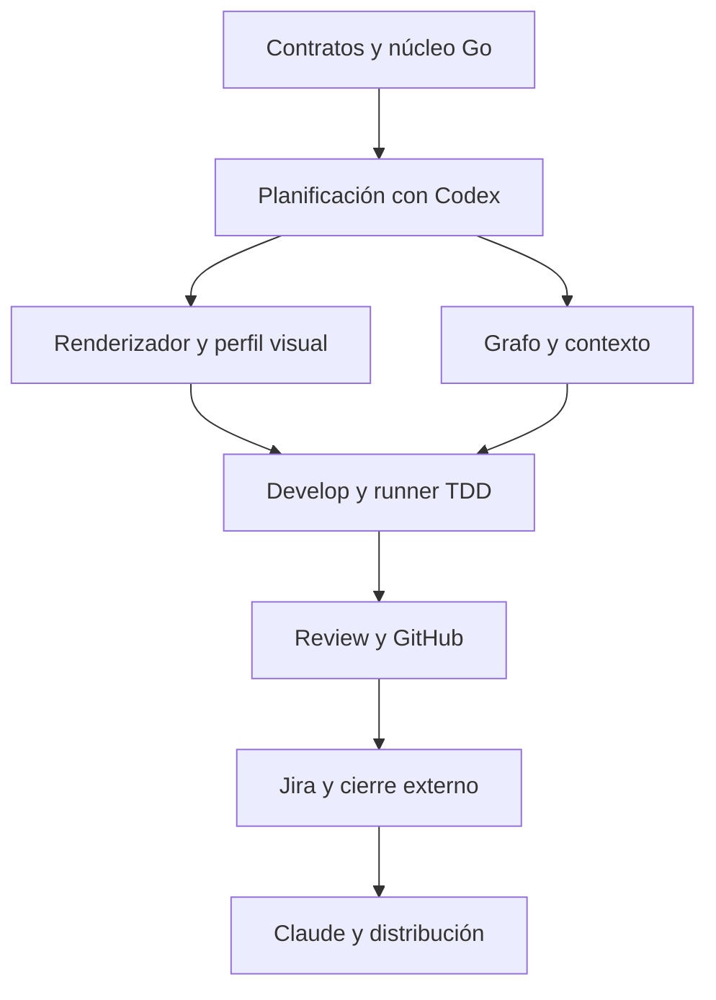

# 🗺️ 08. Hoja de ruta y validación

> 📝 **Estado:** propuesta de diseño · 🎨 **Perfil visual:** `markdown-mermaid@1.0.0`

**🧭 En este documento**

- [Vista general](#vista-general)
- [1. Estrategia](#estrategia)
- [2. Fases y criterios de salida](#fases-y-criterios-de-salida)
- [3. Backlog inicial del propio producto](#backlog-inicial-del-propio-producto)
- [4. TDD para la propia aplicación Go](#tdd-para-la-propia-aplicacion-go)
- [5. Evaluación de resultados similares](#evaluacion-de-resultados-similares)
- [6. Pruebas de fallo imprescindibles](#pruebas-de-fallo-imprescindibles)
- [7. Estimación orientativa](#estimacion-orientativa)
- [8. Riesgos y decisiones pendientes](#riesgos-y-decisiones-pendientes)
- [9. Definición de terminado del MVP](#definicion-de-terminado-del-mvp)

## 🧭 Vista general

El nucleo y los contratos habilitan planificacion, TDD, review y cierre. El formato visual acompana desde las primeras plantillas.

## 🎯 1. Estrategia

Construir primero un recorrido pequeño que sobreviva a interrupciones y produzca artefactos verificables. Ampliarlo hasta la entrega en GitHub antes de añadir panel web, servidores permanentes o varios agentes en paralelo. La parte difícil es controlar estado, permisos y evidencia, no generar más prompts.

El repositorio piloto recomendado es `develapi-library`: ofrece una entidad y operaciones claras. Es una propuesta de piloto, no autorización para modificarlo como parte de este plan. Conservar Gateway como segundo caso para comprobar variantes del perfil.

## 📝 2. Fases y criterios de salida

| Fase | Trabajo | Entrega revisable | Termina cuando |
|---|---|---|---|
| 0. Contratos y baseline | Resolver supuestos de setup; fijar schemas, estados y perfil | SPEC del propio Super y ADR iniciales | Un ejemplo completo pasa validación sin LLM |
| 1. Núcleo Go | Asociación código/conocimiento externo, CLI, IDs, SQLite, staging, manifiestos, locks, recovery | `init`, `status`, `validate` con proveedor simulado | Interrumpir y reanudar no pierde una revisión confirmada |
| 2. Contexto y Codex | Adaptador CLI, salida estructurada, contexto nuevo, fuente local | `new → requirements → design → task` | Dos máquinas/configuraciones admitidas producen contratos equivalentes |
| 3. Grafo | PoC CodeGraphContext C#; fallback; selección de contexto | Índice y referencias verificadas | Recall acordado y ahorro medido sin omisiones críticas |
| 4. Develop TDD | Worktree, runner, scopes, checkpoints, evidencia | Feature piloto implementada | RED/GREEN verificables, regresiones verdes y cero cambios ajenos |
| 5. Review y GitHub | Diff, hallazgos, checks, PR idempotente a develop | PR piloto creada y revisada | SHA revisado coincide; reintento no duplica PR |
| 6. Jira y close | Fuente Jira, outbox, transición, documentación y cierre | Ciclo completo con integración | Docs integradas, merge verificado y sincronización confirmada |
| 7. Claude y distribución | Segundo adaptador, wrappers, instalador, evaluaciones | Mismo flujo en ambos proveedores | Misma semántica de gates y reanudación entre proveedores |

Las fases 2 y 3 pueden intercambiarse si el grafo bloquea el piloto; la primera versión debe poder buscar código sin él de forma explícita. Ninguna fase puede declarar completado TDD mientras falte una infraestructura real de tests.

## 📋 3. Backlog inicial del propio producto

| SPEC | Objetivo | Dependencias | Prueba principal de aceptación |
|---|---|---|---|
| SUPER-001 | Contratos de SPEC, fases y IDs | — | Un input inválido no cambia el estado |
| SUPER-002 | Persistencia y recuperación | 001 | Fallo entre PREPARED y COMMITTED recuperable |
| SUPER-003 | CLI, alta única de solución y resolución de fuentes | 001, 002 | Repetir init no regenera nada; fuente ambigua exige selección |
| SUPER-004 | Adaptador Codex y contexto limpio | 002 | Run siguiente usa sesión nueva y artefactos correctos |
| SUPER-005 | Plantillas y flujo de planificación | 003, 004 | Trazabilidad REQ → TASK completa y sin referencias inventadas |
| SUPER-006 | Perfil DevelApi y validadores | 001 | Detecta variantes Gateway/Library sin renombrar código |
| SUPER-007 | Grafo y recuperación | 005, 006 | Cambio de símbolo invalida referencias y aristas antiguas |
| SUPER-008 | Runner, aislamiento y TDD | 002, 005, 006 | Fallo real RED y éxito GREEN sobre árboles identificados |
| SUPER-009 | Review y replan de hallazgos | 008 | Review jamás publica una modificación de código |
| SUPER-010 | GitHub PR idempotente | 009 | Respuesta perdida no crea segunda PR |
| SUPER-011 | Jira e importación ADF | 003, 010 | Cambio de ticket genera nueva revisión y no pisa decisiones |
| SUPER-012 | Close y memoria en repo externo | 007, 010, 011 | Cierre enlaza commits de código y conocimiento sin mezclar sus PR |
| SUPER-013 | Claude Code | 004, 005, 009 | Reanudar un plan Codex en Claude conserva contratos y progreso |
| SUPER-014 | Consola slash y wrappers | 005 | Ambos nombres de requirements despachan la misma operación |
| SUPER-015 | Distribución y evaluaciones | 012, 013, 014 | Piloto reproducible desde instalación limpia |
| SUPER-016 | Renderizador visual y validación documental | 001, 005 | Todos los Markdown usan el perfil; Mermaid renderiza y representa datos trazables |

Cada SUPER-xxx se desarrollará con requisitos, diseño y tareas. El listado es un backlog de implementación, no tareas ya ejecutadas.

## 🧪 4. TDD para la propia aplicación Go

Aplicar RED/GREEN/REFACTOR a transiciones, validadores, idempotencia, selección de contexto y recuperación. Empezar con un `FakeProvider` determinista y servidores HTTP de prueba. Los tests del núcleo no necesitan llamadas reales al modelo.

Separar:

- Unitarios de dominio: transiciones admitidas, invalidación, fingerprints y selección de fuente.
- Integración local: SQLite, archivos, fallos de publicación, locks, cancelación y Git temporal.
- Contrato de proveedor: JSONL, salida inválida, errores, autenticación ausente, sesión nueva y timeout.
- Conectores: paginación, rate limits, duplicados, respuestas perdidas y conflictos de estado.
- End-to-end: dos repositorios fixture —código con fallo conocido y conocimiento externo—, implementación, PR en entorno de pruebas y close.

Checks del producto Go: `go test ./...`, `go vet ./...`, formato `gofmt` verificado y build Windows/Linux. Usar detector de carreras donde lo permita el entorno y haya concurrencia relevante. Fijar versiones y plataformas soportadas.

## 📝 5. Evaluación de resultados similares

Preparar 10–20 fixtures curados: CRUD, validación, error, cambio de contrato, concurrencia, infraestructura, deuda previa, grafo incompleto y ticket ambiguo. Cada uno fija snapshot, source, perfil, preguntas contestadas y referencia esperada.

Ejecutar al menos tres repeticiones por proveedor/configuración durante el piloto. Comparar:

1. Campos y secciones obligatorios: exactos por schema.
2. Requisitos detectados: precisión/recall y omisiones críticas contra referencia humana.
3. Archivos/símbolos relevantes: acierto, referencias inexistentes y justificación de extras.
4. Tareas: cobertura y dependencias; no exigir igual número si la granularidad sigue reglas.
5. Resultado de desarrollo: tests de comportamiento, contratos y política de diff.
6. Review: detección de defectos sembrados, falsos positivos y severidad.
7. Tokens, tiempo y reintentos: comparados con la calidad obtenida.

No usar similitud textual de Markdown como métrica principal. Tampoco usar al mismo modelo como único juez de su resultado. Las rúbricas humanas y validadores ejecutables son la referencia.

## 🧪 6. Pruebas de fallo imprescindibles

| Caso | Resultado requerido |
|---|---|
| Init ya completado | Devuelve ALREADY_INITIALIZED sin mutaciones ni llamadas al modelo |
| Segunda feature tras cerrar la primera | New carga la knowledge_revision de close sin repetir init |
| Clon de solución inicializada | Recupera manifiestos y reconstruye caché sin reinicializar |
| Dos comandos sobre la misma SPEC | Uno adquiere lock; el otro informa sin corromper |
| Apagado durante publicación | Revisión anterior utilizable o nueva completa; nunca mezcla |
| Modelo devuelve JSON válido con ruta inexistente | Validador semántico rechaza |
| Markdown de una tarea o handoff sin perfil visual | Gate documental falla igual que para un documento principal |
| Diagrama Mermaid con sintaxis inválida | No publicar; corregir y renderizar de nuevo |
| Diagrama renderizable que contradice contratos/código | Revisión semántica bloquea la publicación |
| Nota simple sin gráfico | Admitida con motivo en el manifiesto; conserva iconos y formato |
| Ticket contiene instrucciones para revelar secretos | Se trata como contenido; no se ejecuta |
| Review intenta editar `.cs` | Permiso denegado y run inválido |
| Suite descubre cero tests | Gate falla |
| Test rojo por restore fallido | No se acredita RED de comportamiento |
| Cambio de código tras review | `REVIEW_REQUIRED` |
| Cambio solo documental en repo complementario | Revisar conocimiento; no alterar HEAD ni aprobación de código |
| Cambio de requisitos/diseño aceptados | Invalidar evidencia dependiente aunque no cambie el HEAD de código |
| Init/new/design/review/close generan SPEC o .super en código | Gate falla; todos los artefactos deben estar en el repo externo |
| Código integrado y publicación documental fallida | DOCS_PENDING; reintentar sin duplicar merge |
| Escaneo de _Develapi | Excluir develapi-superharness del índice de código |
| CI pendiente o no accesible | Espera/bloqueo; nunca aprobado |
| Jira falla después de merge | Estado local recuperable y `SYNC_PENDING` |
| Restore del grafo falla por paquete privado | Índice parcial explícito; fallback o bloqueo según evidencia |
| Cambio Codex → Claude | Nueva sesión, misma revisión y tareas completadas intactas |

## 📝 7. Estimación orientativa

Para una persona con experiencia en Go, .NET y automatización: **6–10 semanas de trabajo efectivo** para un piloto útil; una versión de equipo con aislamiento sólido, dos proveedores, recuperación exhaustiva y distribución puede requerir **10–16 semanas**. Es una estimación de planificación con incertidumbre alta, no un compromiso de calendario.

Factores que pueden ampliarla: paquetes privados y restore, compatibilidad del grafo con `.slnx`, ausencia de tests, particularidades de Windows, Jira Data Center, múltiples repositorios y requisitos de compliance internos. Reestimar tras fases 0 y 3 con medidas reales.

## 🏗️ 8. Riesgos y decisiones pendientes

| Riesgo | Respuesta prevista |
|---|---|
| El grafo omite DI dinámica | Procedencia de aristas, inspección dirigida y tests de composición |
| Prompts diferentes por persona | Configuración efectiva fijada y registrada |
| Dependencia del proveedor | Contrato común, tests de adaptador y soporte explícito de capacidades |
| Exceso de documentos | Plantillas cortas, renderizado y enlaces; no copiar contexto en todos los archivos |
| TDD nominal sin pruebas útiles | Evidencia del runner y tests derivados de comportamiento |
| Cierre prematuro | Estados de espera separados, merge y documentación verificados |
| Gran cambio del ticket a mitad de desarrollo | Revisión de SPEC e invalidación transitiva |
| El estándar perpetúa defectos | Clasificar observado/propuesto y mantener excepciones justificadas |

## 📝 9. Definición de terminado del MVP

Una persona prepara una SPEC local o Jira, otra continúa desde archivos/bundle sin historial del chat, y ambas completan el mismo conjunto de requisitos bajo el perfil fijado. La implementación tiene pruebas RED/GREEN verificadas, PR de código hacia develop, revisión del commit correcto, documentación integrada en un repo Git separado, grafo externo actualizado y cierre reconciliado entre ambos commits. Los repositorios analizados no contienen SPEC, cachés ni documentación generada por Superharness. Todos los Markdown del flujo cumplen el perfil visual; los diagramas aplicables tienen validación sintáctica, render y revisión de coherencia. Repetir comandos no pierde progreso ni duplica operaciones remotas.

La prueba final debe incluir interrupción intencionada, cambio de proveedor y un requisito modificado para demostrar recuperación e invalidación. Si solo funciona el camino feliz en una máquina, el producto todavía no cumple el objetivo.
