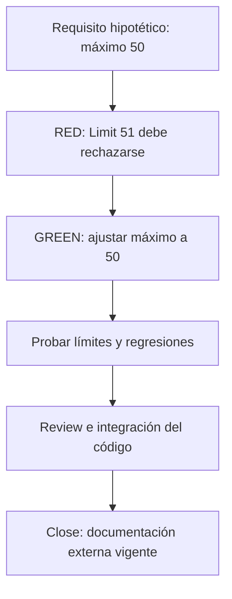

# 🧪 09. Ejemplo completo: cambio de límite de paginación

> 📝 **Estado:** propuesta de diseño · 🎨 **Perfil visual:** `markdown-mermaid@1.0.0`

Este ejemplo es **hipotético y no autorizado para implementación**. Ilustra el flujo usando referencias reales de Library. No existe un ticket Jira confirmado y no se ha cambiado código.


**🧭 En este documento**

- [Vista general](#vista-general)
- [1. Punto de partida verificado](#punto-de-partida-verificado)
- [2. Init: solo en el alta inicial de la solución](#init-solo-en-el-alta-inicial-de-la-solucion)
- [3. New](#new)
- [4. Requirements](#requirements)
- [5. Design](#design)
- [6. Task](#task)
- [7. Develop](#develop)
- [8. Review y PR](#review-y-pr)
- [9. Close y conocimiento para la siguiente feature](#close-y-conocimiento-para-la-siguiente-feature)
- [10. Secuencia de uso prevista](#secuencia-de-uso-prevista)

<a id="vista-general"></a>

## 🧭 Vista general



El ejemplo exige rechazar 51; el codigo actual permite hasta 100. Se registra el fallo, se reduce a 50 y se ejecutan las regresiones.

<a id="punto-de-partida-verificado"></a>

## 📝 1. Punto de partida verificado

`BookGetListRequestValidator` ya valida `Page >= 1` y `1 <= Limit <= 100`. `BookGetListRequest` usa Page=1 y Limit=20 por defecto. `BookGetListService.Validate` ejecuta el validador y lanza `RequestValidationException`; `Execute` delega la consulta paginada. El interactor compartido llama a Validate antes de Execute.

Por tanto, una SPEC que pidiera «rechazar Limit=0» podría ser trabajo de caracterización, no una feature nueva. El agente debe descubrirlo antes de producir una implementación redundante.

Para demostrar una modificación real, supongamos un ticket aceptado: **«Reducir el máximo de libros por página de 100 a 50, conservar el resto del contrato»**. El valor 50 pertenece a este ejemplo, no es una recomendación sobre tu producto.

<a id="init-solo-en-el-alta-inicial-de-la-solucion"></a>

## ⚙️ 2. Init: solo en el alta inicial de la solución

```text
super init --knowledge-root F:\Proyectos\_Develapi\develapi-superharness --code-root F:\Proyectos\_Develapi\develapi-library --solution DevelApi.Library.slnx
```

Este paso solo se realiza si Library aún no está inicializada; se omite para todas las SPEC posteriores. Detecta variante Library, solución, .NET 10, FluentValidation y ausencia de proyecto de tests localizado. Genera mapa, análisis inicial e índice en `develapi-superharness`; no crea artefactos dentro de Library. No crea tests aún: prepara una tarea habilitadora para develop.

<a id="new"></a>

## 📝 3. New

```text
/super-new SPEC-001
```

Resuelve una fuente local configurada o un Jira mapeado explícitamente. Registra el cambio solicitado y preguntas: ¿qué clientes usan páginas mayores de 50?, ¿se rechaza o se ajusta silenciosamente?, ¿qué error contractual se mantiene?

Respuestas asumidas solo para el ejemplo: rechazar; conservar error existente `LimitExceeded`; consumidores informados y cambio aceptado. En una ejecución real, esas respuestas deben guardarse antes de avanzar.

<a id="requirements"></a>

## 🧩 4. Requirements

| ID | Requisito | Verificación |
|---|---|---|
| REQ-001 | Aceptar límites entre 1 y 50, ambos incluidos | Casos 1, 20 y 50 |
| REQ-002 | Rechazar valores mayores de 50 con error de límite excedido | Casos 51, 100 y extremo del tipo |
| REQ-003 | Conservar rechazo de valores menores de 1 | Casos 0 y -1 |
| REQ-004 | Conservar validación de Page y Filter y valor por defecto 20 | Tests de regresión |
| REQ-005 | No consultar libros cuando la validación falla en el flujo | Prueba del interactor/servicio con query spy |

```gherkin
# language: es
@SPEC-001 @REQ-002 @AC-002
Característica: Máximo de libros por página
  Escenario: El límite supera el máximo aceptado
    Dado un BookGetListRequest con Page 1 y Limit 51
    Cuando se valida la petición de listado
    Entonces la validación falla para Limit
    Y el mensaje corresponde a ValidationConstant.LimitExceeded
```

Esto es un escenario a nivel de contrato de aplicación. Para afirmar un status HTTP concreto se debe inspeccionar y probar además el middleware y el endpoint; no se deduce automáticamente del nombre de la excepción.

<a id="design"></a>

## 🏗️ 5. Design

La opción recomendada para este ejemplo es ajustar el máximo del validador existente. No introducir configuración dinámica, una capa nueva o una dependencia. Se conserva el patrón de Dtos y FluentValidation. Revisar el texto de la constante: si menciona 100, debe actualizarse dentro de la misma tarea y probarse.

No hace falta un ADR arquitectónico nuevo si el cambio sigue decisiones existentes. Sí se registra el impacto de compatibilidad y la aceptación del nuevo límite. La matriz de diseño explica qué test demuestra cada requisito.

<a id="task"></a>

## 📋 6. Task

| Tarea | Contenido | Dependencia |
|---|---|---|
| TASK-001 | Crear proyecto y runner de tests si realmente no existen | — |
| TASK-002 | RED para Limit=51; ajustar validador y texto si procede; límites/regresiones | 001 |
| TASK-003 | Verificar que la validación detiene la consulta en el flujo | 001, 002 |

Referencias de código leídas:

- [Validador del listado](F:/Proyectos/_Develapi/develapi-library/src/DevelApi.Library.Dtos/Book/GetList/BookGetListRequestValidator.cs:18).
- [Request y valores por defecto](F:/Proyectos/_Develapi/develapi-library/src/DevelApi.Library.Dtos/Book/GetList/BookGetListRequest.cs:10).
- [Validación del servicio](F:/Proyectos/_Develapi/develapi-library/src/DevelApi.Library.UseCases/Book/GetList/BookGetListService.cs:50).
- [Consulta en Execute](F:/Proyectos/_Develapi/develapi-library/src/DevelApi.Library.UseCases/Book/GetList/BookGetListService.cs:70).
- [Interactor compartido](F:/Proyectos/_Develapi/develapi-core/src/DevelApi.Core.DependencyInjection.Application/Implementations/Interactor.cs).

Estas referencias orientan el ejemplo. En una tarea ejecutable se volverían a resolver contra el snapshot y versiones de paquetes consumidas, con hashes; no se presupone que Library use exactamente el fuente local de Core.

<a id="develop"></a>

## 📝 7. Develop

Para TASK-002, el test que espera rechazo de 51 falla con el código actual porque admite hasta 100. Ese es el RED relevante. Cambiar el máximo hace pasar el test; después ejecutar límites 1/50/51/100, 0/-1 y regresiones de Page/Filter/default.

La tarea habilitadora se identifica como infraestructura. TASK-003 puede resultar una prueba de caracterización verde de un comportamiento ya existente: registrar esa naturaleza, sin fingir un bug. Si se requiere demostrar que el test detecta una regresión, una mutación controlada en un checkout de prueba puede hacerlo; no se introduce un defecto en la rama entregable solo para obtener un RED artificial.

Se conserva el estilo observado: namespace de archivo, `this.RuleFor`, nombre de archivo/tipo y mensajes mediante constantes. No reestructurar capas por un cambio de límite.

<a id="review-y-pr"></a>

## 🔍 8. Review y PR

Review comprueba alcance, ejecución real de tests, constante de error, compatibilidad y trazabilidad. Crea/reutiliza PR a `develop`, con descripción del cambio 100 → 50 y evidencia del commit evaluado.

Si detecta un texto obsoleto en documentación, lo deriva a close; si detecta código o test insuficiente, genera hallazgo para develop. Cualquier nueva modificación de código exige ejecutar las verificaciones pertinentes y revisar el nuevo HEAD.

<a id="close-y-conocimiento-para-la-siguiente-feature"></a>

## 🔄 9. Close y conocimiento para la siguiente feature

Tras el merge autorizado de código a develop, close comprueba la integración y actualiza la documentación de paginación con máximo 50, la SPEC y las capacidades en `develapi-superharness`. El cambio documental se revisa e integra en la rama canónica de ese repo, separada de la PR de código. No requiere modificar ni volver a aprobar el HEAD del producto solo por actualizar documentos externos.

Close registra el commit de código entregado y el commit de conocimiento publicado, actualiza el grafo externo y sincroniza el ticket. Si el código está integrado pero falta publicar la documentación, mantiene DOCS_PENDING.

Una futura SPEC recuperará el contrato vigente de máximo 50 desde `develapi-superharness/.project/develapi-library/`, con su razón y enlaces a SPEC-001. El documento histórico conserva que antes era 100; el índice distingue comportamiento anterior y actual.

<a id="secuencia-de-uso-prevista"></a>

## 📝 10. Secuencia de uso prevista

Ejemplo propuesto, ejecutado desde la raíz del repo de conocimiento. Los flags deben implementarse y no son comandos disponibles todavía.

```text
# Una sola vez por solución; prepara o reutiliza el repo complementario
super init --knowledge-root F:\Proyectos\_Develapi\develapi-superharness --code-root F:\Proyectos\_Develapi\develapi-library --solution DevelApi.Library.slnx
# Ciclo por feature, con raíces resueltas desde la configuración externa
super new SPEC-001 --source local:.inbox/SPEC-001.md
super requirements SPEC-001
super design SPEC-001
super task SPEC-001
super develop SPEC-001
super review SPEC-001
# Merge de código mediante el flujo autorizado del equipo
super close SPEC-001
# Si la documentación requiere PR, integrarla en el repo de conocimiento
# y repetir close para verificar la publicación y completar el cierre
```

La siguiente feature empieza con `super new SPEC-002`: carga la revisión de conocimiento publicada por close de SPEC-001. No vuelve a ejecutar init.

Si un paso queda bloqueado, `super status SPEC-001` muestra la evidencia o pregunta pendiente. Resolverla y repetir el comando conserva el progreso. Las SPEC se guardan en `develapi-superharness/.specs/SPEC-001/` y `.specs/SPEC-002/`; la implementación y tests permanecen en Library.
