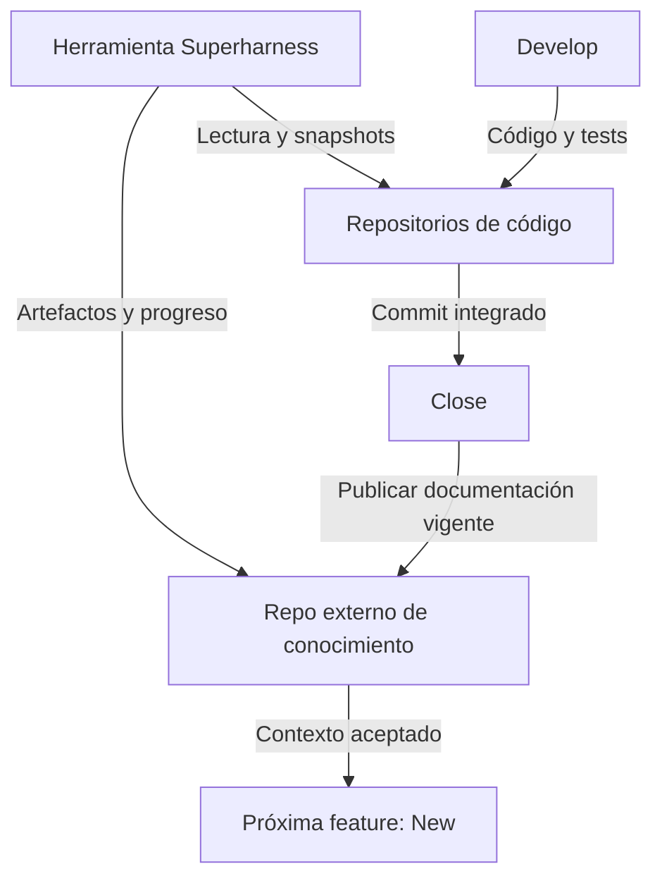

# 📁 11. Repositorio externo de conocimiento

> 📝 **Estado:** propuesta de diseño · 🎨 **Perfil visual:** `markdown-mermaid@1.0.0`


**🧭 En este documento**

- [Vista general](#vista-general)
- [1. Decisión obligatoria](#decision-obligatoria)
- [1.1. Nombres genéricos y carpetas gestionadas](#nombres-genericos-y-carpetas-gestionadas)
- [2. Estructura propuesta](#estructura-propuesta)
- [3. Asociación sin archivos en el código](#asociacion-sin-archivos-en-el-codigo)
- [4. Ciclo de vida](#ciclo-de-vida)
- [5. Dos historiales Git, un cierre trazable](#dos-historiales-git-un-cierre-trazable)
- [6. Fallos, deriva y concurrencia](#fallos-deriva-y-concurrencia)
- [Formato común del conocimiento](#formato-comun-del-conocimiento)
- [7. Criterios de aceptación](#criterios-de-aceptacion)

<a id="vista-general"></a>

## 🧭 Vista general



Superharness lee el codigo, develop lo modifica y todas las fases guardan su conocimiento en un repositorio externo.

<a id="decision-obligatoria"></a>

## 🏗️ 1. Decisión obligatoria

Los archivos generados por Superharness sobre un proyecto analizado se guardan en un **repositorio Git independiente**. Esto incluye análisis inicial, SPEC, requisitos, diseño, ADR, tareas, revisiones, evidencias compartibles, documentación general y manifiestos. Runtime y caché viven fuera del código y quedan ignorados por Git.

Se distinguen tres elementos:

| Elemento | Ejemplo | Responsabilidad |
|---|---|---|
| Repositorio de la herramienta | `F:\Proyectos\superharness` | Implementación Go, plantillas y plan del producto Superharness |
| Repositorios de código analizado | `develapi-core`, `develapi-gateway`, `develapi-library` | Código, pruebas y configuración propia de las aplicaciones |
| Repositorio de conocimiento DevelApi | `F:\Proyectos\_Develapi\develapi-superharness` | Memoria de ingeniería y documentación de las soluciones analizadas |

La carpeta complementaria es hermana de los repositorios de código. No es una subcarpeta, submódulo ni worktree de ellos. Debe tener su propia raíz Git. El análisis no genera allí copias completas del fuente; referencia sus ubicaciones y commits.

<a id="nombres-genericos-y-carpetas-gestionadas"></a>

## 📁 1.1. Nombres genéricos y carpetas gestionadas

El patrón recomendado es `<proyecto>-superharness`, configurable. `develapi-superharness` y su ubicación bajo `F:\Proyectos\_Develapi` son únicamente un ejemplo para DevelApi; no se codifican como nombres fijos de la herramienta ni implican crear ese repositorio ahora.

Las carpetas de primer nivel gestionadas por Superharness llevan un punto inicial: `.baseline/`, `.specs/`, `.project/`, `.inbox/` y `.super/`. El punto distingue esos espacios del contenido manual de la raíz. Dentro se mantienen nombres normales y legibles: `.specs/SPEC-001/tasks/TASK-001.md` y `.project/develapi-library/decisions/`. No es necesario poner un punto en cada subcarpeta ni en cada archivo. `README.md` permanece visible en la raíz como entrada al conocimiento.

El prefijo punto es una convención de nombres: no garantiza el atributo oculto en Windows ni excluye archivos de Git. `.baseline`, `.specs`, `.project`, `.inbox` y los manifiestos/configuración compartibles de `.super` se versionan. Solo se ignoran expresamente runtime, caché, overrides locales y secretos, por ejemplo `.super/runtime/`, `.super/cache/` y `.super/local.yaml`. No usar una regla general que ignore todas las carpetas con punto.

<a id="estructura-propuesta"></a>

## 📁 2. Estructura propuesta

```text
F:\Proyectos\_Develapi\
├── develapi-core\
├── develapi-gateway\
├── develapi-library\
├── develapi-endpoints\
├── develapi-web\
└── develapi-superharness\         # repo Git independiente
    ├── .git\
    ├── .gitignore
    ├── README.md                  # navegación por soluciones y SPEC
    ├── .super\
    │   ├── config.yaml            # asociación con código y soluciones
    │   ├── toolchain.lock.json
    │   ├── solutions\
    │   │   └── develapi-library.json
    │   ├── local.yaml             # ignorado: rutas/overrides del equipo
    │   ├── runtime\               # ignorado: SQLite, runs, logs, staging
    │   └── cache\graph\           # ignorado: índice reconstruible
    ├── .baseline\
    │   └── develapi-library\
    │       ├── analysis.md
    │       ├── project-map.md
    │       ├── standards.md
    │       ├── baseline.json
    │       └── graph-manifest.json
    ├── .inbox\                    # fuentes locales antes de normalizar
    ├── .specs\
    │   ├── SPEC-001\              # análisis, requisitos, diseño, tareas...
    │   └── SPEC-002\
    └── .project\
        ├── overview.md            # mapa general de DevelApi
        ├── spec-index.md          # índice general de SPEC
        ├── develapi-library\
        │   ├── overview.md
        │   ├── architecture.md
        │   ├── standards.md
        │   ├── capabilities.md
        │   ├── contracts.md
        │   ├── operations.md
        │   ├── glossary.md
        │   ├── spec-index.md
        │   ├── adr-index.md
        │   ├── knowledge-manifest.json
        │   └── decisions\
        └── <otras-soluciones-inicializadas>\
```

Solo se crean carpetas para soluciones realmente dadas de alta; no inventar documentación de las demás. `.baseline/` conserva el análisis original. `.project/` representa el conocimiento vigente actualizado por cierres. `.specs/` conserva el historial de trabajo por ID estable.

<a id="asociacion-sin-archivos-en-el-codigo"></a>

## 📝 3. Asociación sin archivos en el código

`.super/config.yaml`, dentro del repo complementario, registra `knowledge_repo_id`, repositorios de código, soluciones y ramas. La ruta `../develapi-library` se resuelve respecto a la raíz del repo de conocimiento; la ruta de la solución se resuelve dentro del repo de código. IDs y hashes identifican objetos, no rutas absolutas particulares de una máquina.

El comando resuelve el contexto desde `--knowledge-root`, desde el directorio actual si pertenece al repo complementario, o desde un registro local de usuario. Si varias asociaciones son posibles, requiere elegir. No crea un archivo marcador dentro del código para descubrir el repo complementario.

Al iniciar, comprobar raíces Git reales y resolver enlaces/junctions. Rechazar un repo de conocimiento anidado en un repo de código, o coincidente con él. Verificar el repo remoto esperado cuando esté configurado, evitando escribir por error en otro checkout. Una ruta relativa que identifica un repo hermano está permitida en el registro de roots; una ruta de artefacto que escape de su root está prohibida.

Los wrappers de chat se instalan como parte de la herramienta, en ámbito de usuario o en el repo de conocimiento. No escribir `.agents`, `.claude`, `AGENTS.md`, `CLAUDE.md`, `.super`, SPEC ni cambios de `.gitignore` de Superharness en los repositorios analizados. Las instrucciones preexistentes del código siguen siendo aplicables.

<a id="ciclo-de-vida"></a>

## 🔄 4. Ciclo de vida

1. **Init, una vez por solución:** leer código y configuración; generar baseline y documentación inicial en el repo complementario; publicar allí el manifiesto INITIALIZED. Si existe y está completo, terminar sin regenerar.
2. **New:** cargar documentación integrada, ADR y manifest vigente; crear `.specs/<SPEC-ID>` en el repo complementario con los commits de entrada fijados.
3. **Requirements/design/task:** leer código y conocimiento; escribir únicamente artefactos externos.
4. **Develop:** modificar código y tests en su worktree autorizado; escribir progreso/evidencia en el repo complementario. Nunca colocar los `.md` de tareas en el checkout del producto.
5. **Review:** revisar la PR de código y dejar informes externos. Enlazar la SPEC por repo, commit y ruta.
6. **Close:** verificar código integrado, actualizar la documentación externa y publicar el conocimiento vigente. Solo después completar el cierre y permitir que se use como nueva baseline de contexto.

El repositorio complementario puede agrupar varias soluciones de DevelApi. En el MVP cada SPEC modifica un único repo de código y declara una solución; leer dependencias de otras soluciones es posible con referencias explícitas. Cambios coordinados en varios repos de código quedan para la evolución prevista.

<a id="dos-historiales-git-un-cierre-trazable"></a>

## 📝 5. Dos historiales Git, un cierre trazable

La rama de integración del código es `develop`, según la petición original. La rama canónica de conocimiento es configurable; se propone `main`. Cada repo mantiene su propio remoto, permisos, branches y política de revisión. No inferir que ambos están alojados en GitHub ni inventar una URL para el repo complementario.

Cada revisión de SPEC registra el commit de conocimiento de entrada y los snapshots de código. La PR de código enlaza la SPEC aceptada en un commit estable. El cierre publica un manifiesto documental con los commits de código realmente integrados; su commit contenedor identifica `knowledge_revision`.

Las fases pueden guardar checkpoints locales frecuentes; publicar commits/ramas de conocimiento se hace según la política configurada. Cuando una referencia de SPEC debe ser accesible desde una PR remota, el commit de conocimiento enlazado debe publicarse y el revisor debe tener acceso. Una ruta `F:\...` no es un enlace compartible.

Un repositorio complementario local cumple la separación y versionado; el trabajo colaborativo requiere configurar su remoto. Esto no se suple subiendo los documentos al repo de código.

Si close prepara documentos antes del merge, estos quedan propuestos en una rama y no sustituyen las capacidades vigentes. Tras el merge, close valida el estado real, integra/publica la documentación según política y registra el par de commits en su recibo. No se requiere una segunda review de código por el mero hecho de cambiar documentos externos; cambios de requisitos o código sí invalidan los gates afectados.

<a id="fallos-deriva-y-concurrencia"></a>

## ⚠️ 6. Fallos, deriva y concurrencia

No hay commit atómico entre ambos repositorios. Persistir fases de cierre y recibos para reintentar sin duplicar PR, commits o transiciones. Código integrado con documentación pendiente implica DOCS_PENDING. No marcar CLOSED ni anunciar la documentación propuesta como comportamiento vigente.

New compara los commits de código registrados en el manifiesto con el snapshot que va a analizar. Si hay cambios integrados fuera de Superharness o cierres pendientes relevantes, identifica el delta y exige reconciliar el conocimiento antes de depender de él. Esta actualización de mantenimiento no repite init ni borra su baseline.

Dos cierres sobre el repo complementario requieren actualización de base, reconciliación de sus diffs documentales y compare-and-swap de la revisión vigente. Nunca usar force-push para ocultar el cierre de otra SPEC. La caché del grafo se separa por repo y snapshot.

Al cambiar de máquina se clonan código y conocimiento; se reconstruyen runtime/caché, sin repetir init. Mantener ACL y retención del conocimiento acordes al contenido analizado; excluir secretos y datos reales innecesarios de fuentes, fragmentos y logs.

<a id="formato-comun-del-conocimiento"></a>

## ⚙️ Formato común del conocimiento

Todos los `.md` generados dentro de `.baseline`, `.specs`, `.project` y las demás carpetas gestionadas aplican [el estándar visual](12-estandar-visual-markdown.md). Esto incluye archivos de cada tarea y ADR, no solo los README. Los diagramas Mermaid permanecen dentro de los Markdown y sus renders temporales se guardan en `.super/runtime/`; no se requieren imágenes externas para leer la fuente.

<a id="criterios-de-aceptacion"></a>

## 📝 7. Criterios de aceptación

- Init, new, requirements, design, task, review y close no añaden archivos de Superharness al código analizado.
- Develop solo añade cambios del producto y sus pruebas/configuración permitidas; su documentación de trabajo permanece externa.
- Cada SPEC tiene su carpeta externa y referencias verificables a solución, repo y snapshots.
- Una segunda feature usa la documentación actualizada por close sin repetir init.
- Un cambio documental externo no altera la PR de código ni sus hashes.
- Close no termina si falta la publicación documental exigida o la integración del código.
- El escáner de código excluye `develapi-superharness` y evita indexar sus propias salidas como fuente.
- El repositorio de la herramienta permanece independiente del conocimiento de DevelApi.

Esta es una definición del plan. La carpeta complementaria y su remoto se crearán/configurarán al implantar el flujo; esta actualización no los ha creado.
