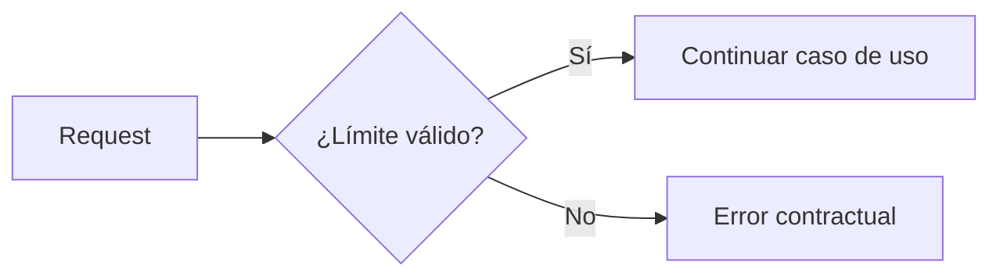
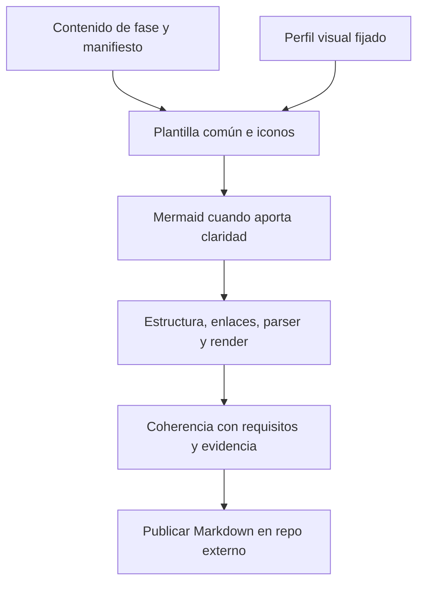

# 🎨 Estándar visual de todos los Markdown

> 📝 **Estado:** propuesta de diseño · 🎨 **Perfil visual:** `markdown-mermaid@1.0.0`

**Perfil:** `markdown-mermaid@1.0.0` · **Alcance:** todos los `.md` que genere cualquier fase del flujo.

> **Regla obligatoria:** el formato común se aplica a cada documento, no solo a los README. Los diagramas se añaden cuando explican información que resulta más clara visualmente.

**🧭 En este documento**

- [Propósito y alcance](#proposito-y-alcance)
- [Anatomía común](#anatomia-comun)
- [Iconos consistentes](#iconos-consistentes)
- [Cuándo incluir Mermaid](#cuando-incluir-mermaid)
- [Reglas de Mermaid](#reglas-de-mermaid)
- [Plantilla completa de ejemplo](#plantilla-completa-de-ejemplo)
- [Generación y publicación](#generacion-y-publicacion)
- [Gates documentales](#gates-documentales)
- [Aplicación a este plan](#aplicacion-a-este-plan)

<a id="proposito-y-alcance"></a>

## 🎯 Propósito y alcance

El perfil cubre análisis inicial, documentación general, SPEC, requisitos, diseños, ADR, cada tarea técnica, preguntas, planes de pruebas, informes de implementación/review/close, handoffs, índices y revisiones históricas generadas. También se usa al actualizar documentación existente mediante close.

Cada archivo tiene título, contexto mínimo, secciones reconocibles e iconos semánticos. Un documento de dos párrafos conserva ese formato sin rellenarlo con secciones vacías. Los diagramas no son obligatorios en todos los archivos: su necesidad depende de las relaciones, secuencias o decisiones que haya que explicar.

Los originales importados de Jira o de archivos se preservan como evidencia. `source.md` presenta esa fuente con el formato común, separando el contenido original de la interpretación; no se alteran citas ni código para insertar iconos. Los archivos JSON, YAML, Gherkin y C# conservan su sintaxis.

<a id="anatomia-comun"></a>

## 📝 Anatomía común

| Elemento | Regla |
|---|---|
| Título H1 | Un título con un icono semántico, tipo de documento e ID cuando exista |
| Metadatos | SPEC/solución, revisión, estado real, procedencia y perfil; datos ausentes se muestran como pendientes |
| Resumen | Una o dos frases sobre la finalidad o el resultado, antes del detalle |
| Navegación | Índice con enlaces en documentos largos; anchors estables independientes de los iconos |
| Secciones | H2/H3 sin saltos arbitrarios; espacios en blanco alrededor de listas, tablas y bloques |
| Información paralela | Tablas para comparar, numeración para secuencias, listas para elementos independientes |
| Estado | Texto además del icono; checklist marcado solo con evidencia o decisión confirmada |
| Código/comandos/rutas | Código en línea o bloque con lenguaje; sin decoración dentro de ejemplos ejecutables |
| Diagrama | Mermaid cuando aporte claridad, con título accesible y explicación textual |
| Cierre del documento | Evidencias, preguntas o siguiente paso cuando sean pertinentes |

El título no necesita llevar literalmente la palabra Resumen si el párrafo inicial ya lo expresa. No usar capturas de código ni imágenes de diagramas como única fuente: Mermaid debe permanecer editable en el `.md`.

<a id="iconos-consistentes"></a>

## ⚙️ Iconos consistentes

| Icono | Uso | Ejemplo |
|---|---|---|
| 🎯 | Objetivo y alcance | Resultado esperado |
| 🧭 | Contexto, navegación y lectura | Índice y mapa del documento |
| 🏗️ | Arquitectura y diseño | Componentes y decisiones |
| 🔄 | Flujo, estados y ciclo de vida | Secuencia de una fase |
| 🧩 | Requisitos, contratos y dependencias | Requisitos y trazabilidad |
| 📋 | Tareas y checklists | Plan técnico |
| 🧪 | Pruebas y validación | Evidencia RED/GREEN |
| 🔍 | Análisis, fuentes y revisión | Hallazgos y procedencia |
| 📁 | Estructura y almacenamiento | Carpetas y repositorios |
| 🔗 | Integraciones y referencias | API y enlaces entre commits |
| ⚙️ | Configuración y herramientas | Parámetros del perfil |
| 📝 | Documento, propuesta o explicación | Estado propuesto |
| ✅ | Confirmación con evidencia | Gate superado, no mera intención |
| ⚠️ | Riesgo o limitación concreta | Dependencia sin resolver |
| ⛔ | Bloqueo confirmado | Falta un requisito crítico |

Un icono por encabezado es suficiente. No decorar cada frase ni emplear cadenas de emojis. Nunca usar ✅ para un test planificado como si ya hubiera pasado. IDs como `SPEC-001`, `REQ-001` y `TASK-001` permanecen en texto y no dependen de símbolos ni colores.

<a id="cuando-incluir-mermaid"></a>

## ⚙️ Cuándo incluir Mermaid

| Documento | Diagrama esperado cuando corresponda |
|---|---|
| Mapa inicial / arquitectura general | Componentes y dependencias relevantes |
| Análisis / brief | Flujo actual y límites del problema si hay varios participantes |
| Requirements | Flujo de comportamiento o estados si el requisito contiene ramas/transiciones |
| Design | Componentes afectados; secuencia cuando intervienen varios servicios |
| ADR | Opciones o impacto de la decisión si el dibujo aporta más que la tabla de alternativas |
| Índice de tareas | DAG cuando haya dependencias entre tareas |
| Tarea individual | Flujo local, secuencia o casos TDD si son necesarios para implementarla |
| Plan de pruebas | Capas/casos y su cobertura cuando ayuden a entender el alcance |
| Implementación / review | Flujo cambiado, impacto o trazabilidad cuando el informe lo requiera |
| Close | Relación entre código integrado, publicación documental y próxima feature |
| Questions / handoff / índices simples | Solo si existe una relación difícil de explicar con texto breve |

El manifiesto del artefacto registra `diagram_policy`, `diagram_included` y una justificación breve cuando se omite. No añadir diagramas vacíos ni el mismo gráfico genérico a todos los documentos para cumplir una cuota.

Priorizar `flowchart` para flujos, dependencias y componentes; `sequenceDiagram` para interacciones; `stateDiagram-v2` para estados; `erDiagram` para modelos de datos y `classDiagram` para contratos/tipos cuando sean relevantes. Cada tipo adicional debe incorporarse al renderer probado. Un árbol de carpetas puede seguir siendo un bloque `text`: ya expresa bien la jerarquía.

<a id="reglas-de-mermaid"></a>

## ⚙️ Reglas de Mermaid

1. Usar bloques de lenguaje `mermaid`; IDs internos simples y estables, separados de las etiquetas visibles.
2. Mantener sintaxis compatible con la versión fijada. Escapar etiquetas y encerrar texto Unicode o especial correctamente; no inyectar títulos de tickets sin sanitización.
3. Mostrar una idea por diagrama, con etiquetas cortas y dirección consistente. Objetivo orientativo: hasta 12 nodos; si la lectura se complica, dividir por responsabilidad.
4. Añadir `accTitle` y `accDescr`, más un breve texto fuera del bloque que permita entenderlo aunque el visor no renderice Mermaid.
5. Evitar dependencias de iconos externos, HTML en etiquetas, scripts, enlaces ejecutables o directivas arbitrarias. El renderer controla su configuración de seguridad y estilo.
6. No depender exclusivamente del color: describir estados y relaciones con palabras. Verificar legibilidad con fondos claros y oscuros en los visores admitidos.
7. Referenciar nodos/relaciones a requisitos, símbolos, tareas o decisiones cuando afirmen algo del proyecto. Distinguir lo observado de lo propuesto.
8. Cambios en código/diseño invalidan los gráficos derivados afectados. Close actualiza documentos y diagramas juntos; nunca deja un dibujo antiguo bajo texto nuevo.

La sintaxis de [flowcharts](https://mermaid.js.org/syntax/flowchart.html) y [secuencias](https://mermaid.js.org/syntax/sequenceDiagram.html) está documentada por Mermaid. El soporte efectivo se valida con la versión seleccionada y los visores del equipo.

<a id="plantilla-completa-de-ejemplo"></a>

## 📝 Plantilla completa de ejemplo

Ejemplo ilustrativo de una tarea, no evidencia de trabajo ejecutado. El bloque exterior permite copiar el Markdown con su Mermaid anidado.

````markdown
# 📋 TASK-002 — Validar el máximo de paginación

> 📝 **Estado:** pendiente · **SPEC:** SPEC-001 · **Revisión:** 1

## 🎯 Objetivo

Rechazar un límite superior al máximo aprobado, conservando el contrato de error.

## 🧩 Contexto y referencias

| Requisito | Referencia |
|---|---|
| REQ-002 | Enlace al requisito aceptado y snapshot de código |

## 🔄 Flujo esperado



El validador decide antes de que el flujo ejecute la consulta de negocio.

## 🧪 Verificación

- [ ] RED registrado con el fallo de comportamiento esperado.
- [ ] GREEN registrado para el nuevo límite.
- [ ] Regresiones pertinentes ejecutadas.

## 🔗 Evidencia y siguiente paso

Referencias pendientes de completar por el runner al ejecutar la tarea.
````

<a id="generacion-y-publicacion"></a>

## 📝 Generación y publicación



Todos los caminos de generación deben llamar al mismo renderizador: comandos iniciales, reintentos, tareas individuales, regeneración de vistas y close. No se permite publicar Markdown libre del modelo sin normalizar y validar. Las relaciones para diagramas pueden venir del modelo, pero el motor verifica IDs y procedencia y aplica la plantilla de dibujo.

`visual_profile`, `template_version` y `mermaid_version` forman parte de `toolchain.lock.json` y de los fingerprints. Registrar la versión realmente usada; una actualización del perfil crea otra revisión documental y no cambia silenciosamente archivos históricos aceptados.

<a id="gates-documentales"></a>

## 🧪 Gates documentales

| Regla | Comprobación |
|---|---|
| DOC-001 | Todo `.md` emitido por el flujo está registrado y declara su perfil visual |
| DOC-002 | Título, estructura, iconos semánticos y metadatos adecuados al tipo |
| DOC-003 | Tablas, fences, listas, referencias y anchors válidos |
| DOC-004 | Si corresponde diagrama, existe y se conserva como fuente Mermaid |
| DOC-005 | Cada Mermaid parsea y renderiza con la versión fijada; salida sin errores |
| DOC-006 | Diagrama y texto describen los mismos requisitos/estados/componentes |
| DOC-007 | Confirmaciones, checklists y estados positivos tienen evidencia real |
| DOC-008 | Ningún artefacto visual/documental se publica en el repo de código analizado |

La revisión semántica y visual no se reduce a regex: revisar etiquetas cortadas, cruces confusos, orden de lectura y contradicciones. Si el renderer no está disponible, registrar el bloqueo de validación; no declarar Mermaid verificado. El pipeline puede usar [Mermaid CLI](https://github.com/mermaid-js/mermaid-cli) o la biblioteca fijada con un navegador local. No enviar código o diagramas privados a un servicio público para renderizarlos.

Los PNG/SVG de QA viven en `.super/runtime/` ignorado. El entregable canónico sigue siendo el `.md` con Mermaid. Un visor sin soporte conserva el bloque y la explicación textual; opcionalmente se puede exportar una imagen junto a una entrega solicitada, sin reemplazar la fuente.

<a id="aplicacion-a-este-plan"></a>

## 📝 Aplicación a este plan

Este documento define una capacidad a implementar, no afirma que el motor Go ya exista. El plan actual adopta títulos con iconos, navegación y diagramas útiles como referencia de presentación. Los comandos y templates futuros deben demostrar los gates anteriores en pruebas que incluyan todos los tipos de Markdown, no solo un README.
