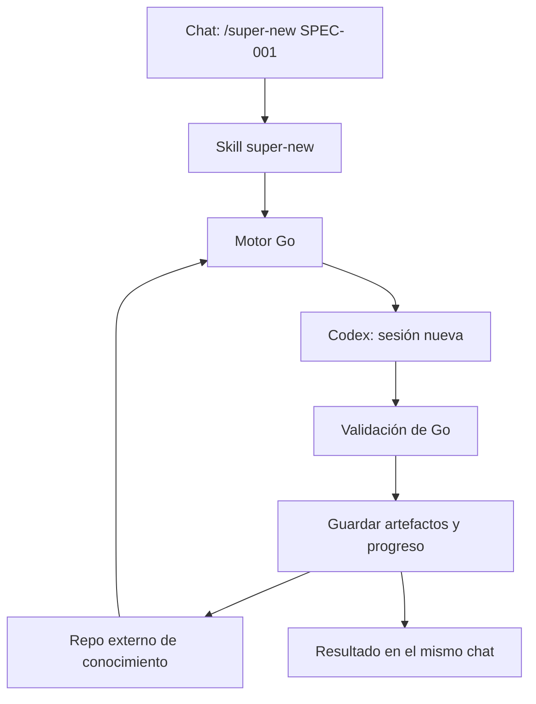

# 💬 13. Todos los comandos desde esta ventana de Codex

> 📝 **Estado:** contrato propuesto, pendiente de implementación · 🎨 **Perfil visual:** `markdown-mermaid@1.0.0`
> 🎯 **Objetivo:** escribir `/super-new SPEC-001` aquí y que Codex invoque automáticamente el motor Go.

**🧭 En este documento**

- [Experiencia de uso](#experiencia)
- [Instalación y proyecto activo](#instalacion)
- [Contrato de despacho](#despacho)
- [Contexto nuevo y progreso](#contexto)
- [Plan de entrega y aceptación](#entrega)

<a id="experiencia"></a>

## 💬 Experiencia de uso

El usuario utiliza este chat para todo el flujo. El ejecutable compilado `super.exe` contiene el motor Go: no se ejecutará `go run` ni se compilará el programa con cada comando. Go será necesario para desarrollar y construir Superharness; la instalación de usuario distribuirá el binario y las skills compatibles.



El chat recibe el resultado del motor. El trabajador obtiene únicamente las entradas persistidas y verificadas de la fase.

| Escribes en Codex | Operación del motor |
|---|---|
| `/super-init` | Alta única de la solución |
| `/super-new SPEC-001` | Analizar fuente local o Jira |
| `/super-requeriments SPEC-001` | Requisitos y aceptación; alias de `/super-requirements` |
| `/super-design SPEC-001` | Diseño y ADR |
| `/super-task SPEC-001` | Tareas técnicas |
| `/super-develop SPEC-001` | Implementación TDD |
| `/super-review SPEC-001` | Verificación y PR a develop |
| `/super-close SPEC-001` | Cierre y conocimiento vigente |
| `/super-status SPEC-001` | Estado, bloqueos y siguiente paso |
| `/super-doctor` | Diagnóstico de instalación y capacidades |
| `/super-validate SPEC-001` | Validación de artefactos |
| `/super-answer SPEC-001 Q-001 --file respuesta.md` | Registrar respuesta a una pregunta |
| `/super-sync SPEC-001` | Reconciliar operaciones remotas pendientes |

Todas las opciones de fase —por ejemplo `--source`, `--resume` o `--prepare`— se pasan por el mismo chat y se validan en Go. No es necesario abrir una terminal. No se añade una consola propia al MVP.

La documentación oficial describe skills habilitadas en el menú slash e invocación explícita mediante `$`. El requisito de producto es comprobar `/super-new` en esta superficie, tanto escribiéndolo como seleccionándolo en el menú. Si una versión solo admite `$super-new`, se documentará esa compatibilidad como alternativa dentro del chat; no se declarará cumplida la sintaxis slash exacta hasta probarla. [Referencia oficial de comandos](https://learn.chatgpt.com/docs/reference/slash-commands).

<a id="instalacion"></a>

## ⚙️ Instalación y proyecto activo

La instalación ocurre una vez por equipo/usuario y puede actualizarse sin repetir el análisis inicial. El instalador verificará binario, versión, ruta absoluta, autenticación del proveedor y descubrimiento de las skills. Una skill no puede invocar Go si el motor todavía no existe.

Se distribuirá una skill por operación, con nombre estable y una plantilla común de despacho. La lógica de negocio y los estados viven en Go. Las skills se instalan en un ámbito de usuario admitido por la versión o se distribuyen mediante un plugin. Nunca se escriben en el código analizado. La documentación actual describe `~/.agents/skills` para ámbito de usuario; se debe detectar la ubicación compatible, incluidas instalaciones existentes, y verificar el descubrimiento real. [Creación y distribución de skills](https://learn.chatgpt.com/docs/build-skills).

**Binding persistido:** asociar una raíz de proyecto del chat con `solution_id`, `code_root`, `knowledge_root` y la ruta/version del ejecutable. Las rutas locales pertenecen al registro de usuario o a overrides ignorados por Git; los identificadores y las políticas compartidas pertenecen al repo de conocimiento.

Orden de resolución propuesto:

1. Parámetros explícitos del comando, validados contra identidades Git/solución.
2. Asociación persistida de la raíz de trabajo actual.
3. Si no existe asociación única, devolver `PROJECT_BINDING_REQUIRED` con las opciones conocidas.

No usar como selector «el último proyecto usado» ni una ruta recordada por el modelo. No asumir que una SPEC tiene identidad global. Dos soluciones pueden tener un `SPEC-001`; la clave efectiva incluye solución y repositorio de conocimiento.

Durante el setup se registra la asociación; si falta, `/super-init` recoge las rutas una sola vez o las acepta explícitamente. Ejemplo de alta:

```text
/super-init --knowledge-root F:\Proyectos\_Develapi\develapi-superharness --code-root F:\Proyectos\_Develapi\develapi-library --solution DevelApi.Library.slnx
```

Este ejemplo corresponde a Library, no a todo el conjunto _Develapi. Abrir el proyecto correcto en Codex permite reutilizar el binding; desde un chat con otra raíz se debe indicar la asociación. El directorio de esta conversación puede ser distinto de `F:\Proyectos\superharness`: mencionar una ruta no cambia automáticamente el directorio de ejecución de las herramientas.

En otro equipo se recupera el conocimiento compartido y se registran las rutas locales. No se reinicializa la solución; `/super-init` ya completado devuelve `ALREADY_INITIALIZED`.

<a id="despacho"></a>

## 🧩 Contrato de despacho

Contrato a implementar, no CLI disponible actualmente:

```text
super new SPEC-001 --knowledge-root <ruta-resuelta> --solution <id> --output json
```

1. La skill toma su operación fija y argumentos explícitos; no transforma conversación libre en requisitos adicionales.
2. Comprueba instalación y binding. Invoca el binario registrado, sin descargar ni sustituir ejecutables por su cuenta.
3. Pasa argumentos separados. Texto largo y respuestas se transportan en archivo de solicitud o stdin estructurado; nunca concatenar el texto del ticket en una orden shell.
4. Go valida operación, ID, rutas, estado previo y permisos; fija fingerprints y adquiere el lock. El alias `requeriments` se normaliza a `requirements`.
5. Go crea el run y ejecuta el proveedor; la skill presenta progreso del run sin lanzar una segunda ejecución.
6. Go publica el resultado validado; la skill devuelve estado, enlaces a archivos, bloqueos y siguiente comando permitido.

El protocolo tendrá versión propia. Salida JSON con `protocol_version`, `run_id`, `solution_id`, `spec_id`, `phase`, `run_status`, `spec_status`, `artifact_refs`, `blocking_questions` y `next_commands`. Los eventos intermedios van por un canal definido distinto de la respuesta JSON final. Código de salida, timeout o error de parseo nunca se presentan como éxito.

El runner usa invocaciones acotadas y consulta de estado por `run_id` para mostrar avances. La primera entrega supervisa el proceso; si la sesión se interrumpe, reconcilia su estado y checkpoints antes de reanudar. No promete que un proceso continúe vivo después de cerrar la app. Reintentar consulta primero el run activo y los fingerprints para evitar duplicados.

**Límites de la skill:** no escribe artefactos finales a mano, no decide saltar gates, no hace llamadas directas a Jira/GitHub y no implementa código dentro del chat principal. Si falta el binario, informa `ENGINE_NOT_INSTALLED`; si el motor devuelve bloqueo, lo conserva. Las autorizaciones del host siguen aplicando: automatizar el despacho no concede permisos adicionales.

**Reproducibilidad:** fijar versión del binario, skill, protocolo, perfiles, prompts y proveedor. Un cambio de modelo en el chat de entrada no cambia el modelo de ejecución configurado en Go. El despacho se prueba de forma exacta; el contenido de IA se evalúa por contratos y cobertura, sin prometer texto idéntico.

<a id="contexto"></a>

## 🔄 Contexto nuevo y progreso

Cada comando de fase abre un proceso de proveedor nuevo. No usa resume/continue de una conversación anterior. La reanudación de Superharness se hace desde checkpoints, manifiestos y handoffs, con contexto nuevo.

El historial visible de esta ventana puede permanecer. El requisito de limpieza se cumple en el trabajador: recibe el paquete construido por Go y no la conversación anterior. No se promete pulsar `/clear`, vaciar la UI ni borrar el historial automáticamente.

El prompt del trabajador identifica fase, run y contrato; no incluye `/super-new` como instrucción de entrada ni solicita invocar otra vez la skill de despacho. El adaptador debe impedir recursión mediante un marcador de ejecución y capacidades restringidas: el trabajador no dispone de operaciones para iniciar otro workflow. Las instrucciones preexistentes del código se respetan y se registran como inputs; la configuración personal no debe alterar silenciosamente las reglas fijadas.

Los archivos se guardan en el repo externo: `.specs/SPEC-001/`, `.project/<solution-id>/` y el runtime ignorado bajo `.super/`. Cada close publica conocimiento que usa el siguiente new. El chat puede cerrarse o cambiar de usuario sin perder el progreso confirmado.

Codex puede ser la interfaz y Claude el trabajador si así se configura el proveedor. Para usar también el chat de Claude, se distribuye su adaptador de entrada conservando el mismo contrato Go; no se copian reglas de negocio a prompts específicos.

<a id="entrega"></a>

## 🧪 Plan de entrega y aceptación

1. **Núcleo mínimo:** binario Go con protocolo JSON, resolución de proyecto y estado persistido. Proveedor simulado para comprobar el contrato.
2. **Entrada desde Codex:** instalador mínimo y skills de comandos, incluyendo aliases. Verificar selección real en el menú y envío literal desde esta ventana.
3. **Primera fase real:** `/super-new` lee una fuente local, lanza un trabajador nuevo y devuelve documentos externos con el perfil visual.
4. **Continuidad:** ejecutar requirements en un contexto nuevo y desde otro chat correctamente asociado; debe usar exactamente la revisión aceptada.
5. **Ampliación:** habilitar el resto de fases, TDD, Jira/GitHub y close con sus gates. Un comando aún no implementado devuelve `PHASE_NOT_IMPLEMENTED`.
6. **Portabilidad:** probar el trabajador Claude y después su interfaz de chat contra las mismas fixtures.

| Prueba | Evidencia de aceptación |
|---|---|
| `/super-new SPEC-001` desde esta ventana | Invocación del binario esperado, run real y rutas de resultado |
| Mismo ID en dos proyectos | Binding explícito o bloqueo; nunca mezcla |
| Repetición tras corte | Recuperación de checkpoint y ausencia de publicaciones duplicadas |
| Historial con instrucciones contradictorias | No llega al trabajador ni modifica el contrato |
| Alias con errata | Mismos argumentos normalizados y misma operación |
| Skill/binario incompatible | Error antes de mutaciones |
| Nueva feature tras close | Usa la knowledge_revision publicada sin repetir init |
| Fase fuera de orden | Go bloquea y devuelve el siguiente paso válido |

**Estado actual:** solo se ha documentado este contrato. Aún no existen el binario Superharness ni las skills `super-*` instaladas. La disponibilidad futura se acreditará con la prueba desde el chat, no con la presencia de estos Markdown.
