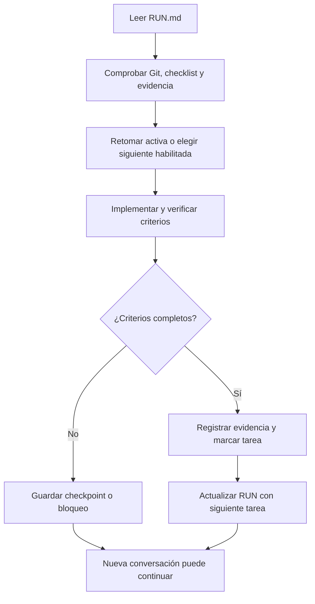

# ✅ 14. Plan de acción para construir Superharness

> 📝 **Estado:** listo para empezar; 0 de 26 tareas de desarrollo completadas · 🎨 **Perfil visual:** `markdown-mermaid@1.0.0`
> 🚪 **Entrada para la IA:** [RUN.md](../RUN.md) · 🧾 **Evidencias y sesiones:** [registro](../.execution/LOG.md)

Este documento convierte el roadmap en trabajo comprobable. Los IDs SH-xxx son tareas de construcción de la herramienta; SUPER-xxx identifica la capacidad del backlog original. No son SPEC de DevelApi ni comandos ya implementados.

## 🧭 Cómo seguirlo

La IA comienza leyendo RUN.md. Ese archivo contiene las reglas de continuación, la tarea actual y el punto de reanudación. Después lee solo la ficha seleccionada, sus referencias y el código afectado. No necesita el historial del chat ni cargar todos los documentos cada vez.

**Una casilla se marca únicamente con evidencia y todos los criterios de su ficha cumplidos.** El checklist es la fuente de verdad de terminación; RUN es el cursor y el registro conserva pruebas/decisiones. Ante discrepancias, se reconcilian los tres antes de hacer trabajo nuevo.

Una interrupción conserva trabajo parcial sin convertirlo en tarea terminada. El siguiente chat verifica el checkpoint antes de reanudar.

**Orden por defecto:** SH-001 → SH-026, saltando únicamente una tarea bloqueada si existe otra independiente con dependencias completas y se registra el motivo. SH-020 puede adelantarse tras SH-016. Una tarea grande puede dividirse en subtareas SH-xxx-01 dentro de su ficha antes de implementarla; su casilla principal sigue abierta hasta cumplir el contrato original.

## 📋 Checklist principal

- [ ] [SH-001 — Contratos y decisiones de arranque](#sh-001)
- [ ] [SH-002 — Entorno y esqueleto Go](#sh-002)
- [ ] [SH-003 — Dominio, IDs y máquina de estados](#sh-003)
- [ ] [SH-004 — Diario, revisiones y recuperación](#sh-004)
- [ ] [SH-005 — Rutas externas y asociación de proyecto](#sh-005)
- [ ] [SH-006 — CLI interna y diagnóstico](#sh-006)
- [ ] [SH-007 — Proveedor simulado y paquetes de contexto](#sh-007)
- [ ] [SH-008 — Alta única de solución](#sh-008)
- [ ] [SH-009 — Skills e instalación mínima desde Codex](#sh-009)
- [ ] [SH-010 — Renderizador Markdown y validación visual](#sh-010)
- [ ] [SH-011 — Ejecutor Codex con contexto nuevo](#sh-011)
- [ ] [SH-012 — New con fuente local](#sh-012)
- [ ] [SH-013 — Respuestas, requisitos y Gherkin](#sh-013)
- [ ] [SH-014 — Diseño y ADR trazables](#sh-014)
- [ ] [SH-015 — Tareas técnicas y DAG](#sh-015)
- [ ] [SH-016 — Perfil .NET basado en evidencia](#sh-016)
- [ ] [SH-017 — Runner y aislamiento de desarrollo](#sh-017)
- [ ] [SH-018 — Develop con TDD y checkpoints](#sh-018)
- [ ] [SH-019 — Review local y correcciones](#sh-019)
- [ ] [SH-020 — Codegraph incremental y medición](#sh-020)
- [ ] [SH-021 — GitHub y PR a develop](#sh-021)
- [ ] [SH-022 — Jira y sincronización recuperable](#sh-022)
- [ ] [SH-023 — Close y conocimiento para la siguiente SPEC](#sh-023)
- [ ] [SH-024 — Claude con los mismos contratos](#sh-024)
- [ ] [SH-025 — Distribución y evaluación de equipo](#sh-025)
- [ ] [SH-026 — Piloto completo y adopción](#sh-026)

## 🎯 Hitos verificables

| Hito | Tareas exigidas | Resultado observable |
|---|---|---|
| H1. Motor invocable desde Codex | SH-001 a SH-009 | /super-init y diagnóstico desde el chat con estado externo; no se presenta new como implementado |
| H2. Planificación completa | H1 y SH-010 a SH-015 | New, requirements, design y task reales; contexto nuevo por fase |
| H3. Desarrollo y review local | H2 y SH-016 a SH-019 | TDD verificable, aislamiento y revisión del commit correcto |
| H4. Ciclo conectado | H3 y SH-020 a SH-023 | Grafo evaluado, Jira/GitHub, PR a develop y close alimentando la próxima feature |
| H5. Portabilidad y adopción | H4 y SH-024 a SH-026 | Claude, distribución y piloto reproducible entre personas |

Los hitos se deducen de tareas con evidencia, no se marcan en un segundo checklist. Las dependencias de las fichas son las que gobiernan el orden; esta tabla resume entregas.

## 🧪 Reglas comunes de desarrollo

- SDD: leer requisitos/diseño, resolver contradicciones y detallar la tarea antes de editar código. Si cambia el alcance, actualizar el contrato y las dependencias.
- TDD para comportamiento: registrar RED real, GREEN y refactorización. Documentación/bootstrap no requieren inventar un test rojo.
- Probar con repositorios fixture temporales de código y conocimiento separados; no usar proyectos reales para pruebas destructivas o mutaciones remotas.
- Ejecutar checks pertinentes y guardar comando, cwd, resultado y snapshot. Cuando exista módulo: `go test ./...`, `go vet ./...`, `go build ./cmd/super` y formato sin diferencias como gate de integración; no dar comandos por ejecutados.
- No usar /super-* para construir esta primera versión mientras esos comandos no existan. La IA implementa el motor mediante el procedimiento manual de RUN. El requisito «solo develop escribe código» será obligatorio para las fases del producto cuando se habiliten.
- Este plan manual y .execution son documentación de construcción de la herramienta. No sustituyen su futuro repositorio externo de conocimiento si se autoanaliza, ni permiten guardar SPEC de clientes en este repo.
- Las rutas internas propuestas se concretan durante la tarea y se registran; no crear capas vacías solo por seguir una lista.
- No inferir autorización de publicación, merge o cambios en proyectos reales de una casilla pendiente; conservar las autorizaciones explícitas de la sesión.
- Si falta un servicio/credencial, completar las pruebas simuladas independientes y registrar la verificación real como pendiente. No marcar completa una tarea que aún la exige.

## 🛠️ Fichas de ejecución

### 📌 SH-001 — Contratos y decisiones de arranque

**Dependencias:** ninguna · **Backlog:** SUPER-001

**Objetivo:** Fijar contrato mínimo antes de elegir bibliotecas o generar código.

**Leer:** [01](01-vision-y-decisiones.md) · [02](02-comandos-y-ciclo.md) · [03](03-arquitectura-go-y-estado.md) · [07](07-contratos-y-plantillas.md) · [11](11-repositorio-de-conocimiento.md) · [13](13-interfaz-codex-y-despacho.md).

**Entregables:** Schemas versionados de SPEC, run, comando y respuesta; tabla de transiciones; ADR de bootstrap, almacenamiento y límites de rutas.

**Alcance técnico:** Artefactos de diseño en .execution/contracts/; ejemplos válidos e inválidos por contrato. Ningún cambio en DevelApi.

**Aceptación y prueba:** Comprobar manualmente REQUIRED/OPTIONAL, enums, errores, versionado y correspondencia con fases; no afirmar validación ejecutable hasta SH-003.

**Atención para reanudar:** Contrato ambiguo o incompatibilidad entre documentos: registrar decisión y corregir antes del módulo Go.

**Evidencia:** al completar, registrar el ID de sesión y referencias verificables en [.execution/LOG.md](../.execution/LOG.md); después marcar la casilla principal.

### 📌 SH-002 — Entorno y esqueleto Go

**Dependencias:** SH-001 · **Backlog:** SUPER-001

**Objetivo:** Preparar un módulo compilable y reproducible para Windows.

**Leer:** [03](03-arquitectura-go-y-estado.md) · [08](08-roadmap-y-validacion.md).

**Entregables:** go.mod, cmd/super/main.go, internal/ inicial, .gitignore de build/runtime y herramienta de formato; fijar toolchain tras verificar disponibilidad.

**Alcance técnico:** Usar module github.com/chrismdiez/superharness; distribución como super.exe. No añadir dependencias sin justificar.

**Aceptación y prueba:** go version; go test ./...; go vet ./...; go build ./cmd/super; gofmt sin diferencias. Guardar salida y número real de tests; un módulo vacío solo acredita bootstrap.

**Atención para reanudar:** Go no se detectó en PATH: buscar instalación existente y preparar la requerida según permisos del entorno; no elegir una versión por memoria.

**Evidencia:** al completar, registrar el ID de sesión y referencias verificables en [.execution/LOG.md](../.execution/LOG.md); después marcar la casilla principal.

### 📌 SH-003 — Dominio, IDs y máquina de estados

**Dependencias:** SH-002 · **Backlog:** SUPER-001

**Objetivo:** Implementar validación y transiciones sin proveedor ni red.

**Leer:** [02](02-comandos-y-ciclo.md) · [03](03-arquitectura-go-y-estado.md) · [07](07-contratos-y-plantillas.md).

**Entregables:** internal/domain y validadores de contratos; errores tipados, estados de SPEC/run, aliases y fixtures.

**Alcance técnico:** Validar IDs, precondiciones, invalidación transitiva y last_valid_phase; mantener el dominio ajeno a flags de proveedores.

**Aceptación y prueba:** TDD: entradas inválidas, transición fuera de orden, requisito cambiado e ID duplicado dentro de la solución; verificar ausencia de mutación ante rechazo.

**Atención para reanudar:** Las fixtures deben cubrir errores observables, no limitarse a copiar enums.

**Evidencia:** al completar, registrar el ID de sesión y referencias verificables en [.execution/LOG.md](../.execution/LOG.md); después marcar la casilla principal.

### 📌 SH-004 — Diario, revisiones y recuperación

**Dependencias:** SH-003 · **Backlog:** SUPER-002

**Objetivo:** Persistir ejecución y publicar artefactos sin dejar revisiones mezcladas.

**Leer:** [03](03-arquitectura-go-y-estado.md) · [07](07-contratos-y-plantillas.md).

**Entregables:** internal/state y storage; SQLite con migraciones, staging, manifests, hashes, locks y recovery.

**Alcance técnico:** Elegir driver tras comprobar Windows/distribución; contratos y evidencias en repo de conocimiento, caché/diario local ignorados.

**Aceptación y prueba:** TDD e integración: corte antes/después de publicación, lock ocupado, lock abandonado, revisión incompleta, reapertura del diario e inputs iguales.

**Atención para reanudar:** Reconciliar archivos y diario; nunca reparar marcando éxito sin artefactos verificados.

**Evidencia:** al completar, registrar el ID de sesión y referencias verificables en [.execution/LOG.md](../.execution/LOG.md); después marcar la casilla principal.

### 📌 SH-005 — Rutas externas y asociación de proyecto

**Dependencias:** SH-004 · **Backlog:** SUPER-003 / SUPER-014

**Objetivo:** Resolver identidades de código, conocimiento y solución sin memoria del chat.

**Leer:** [03](03-arquitectura-go-y-estado.md) · [11](11-repositorio-de-conocimiento.md) · [13](13-interfaz-codex-y-despacho.md).

**Entregables:** internal/workspace y chatbridge; registro local, overrides, scopes de escritura y binding explícito.

**Alcance técnico:** Canonicalizar rutas, enlaces/junctions y solapamientos; excluir conocimiento del grafo si es hermano del código.

**Aceptación y prueba:** TDD: mismo SPEC en dos soluciones, asociación ausente, rutas con espacios, traversal y alias mediante enlaces; rechazo antes de escribir.

**Atención para reanudar:** No usar cwd como prueba suficiente de identidad ni elegir el último proyecto.

**Evidencia:** al completar, registrar el ID de sesión y referencias verificables en [.execution/LOG.md](../.execution/LOG.md); después marcar la casilla principal.

### 📌 SH-006 — CLI interna y diagnóstico

**Dependencias:** SH-005 · **Backlog:** SUPER-003

**Objetivo:** Exponer el protocolo que invocarán las skills.

**Leer:** [02](02-comandos-y-ciclo.md) · [03](03-arquitectura-go-y-estado.md) · [13](13-interfaz-codex-y-despacho.md).

**Entregables:** cmd/super e internal/cli; output JSON versionado, status, doctor, validate y errores PHASE_NOT_IMPLEMENTED.

**Alcance técnico:** Separar salida final de eventos/logs; parsear argumentos sin shell concatenado; dar alias a requirements/requeriments.

**Aceptación y prueba:** Pruebas de proceso: exit codes, JSON limpio, parámetro inválido, fuente ambigua, binario ausente/incompatible y error sin mutación.

**Atención para reanudar:** Registrar comandos aún no implementados como tales, sin simular resultados.

**Evidencia:** al completar, registrar el ID de sesión y referencias verificables en [.execution/LOG.md](../.execution/LOG.md); después marcar la casilla principal.

### 📌 SH-007 — Proveedor simulado y paquetes de contexto

**Dependencias:** SH-006 · **Backlog:** SUPER-004 / SUPER-005

**Objetivo:** Probar el flujo antes de gastar tokens.

**Leer:** [03](03-arquitectura-go-y-estado.md) · [04](04-grafo-y-contexto.md) · [07](07-contratos-y-plantillas.md).

**Entregables:** Provider interface, FakeProvider, schemas de salida, fingerprints y constructor de contexto.

**Alcance técnico:** Paquete con versiones, políticas, manifest, fuentes y presupuesto; historial del chat excluido.

**Aceptación y prueba:** TDD: salida inválida, referencias inexistentes, límites de contexto, mismo input y cambio de snapshot; FakeProvider sin llamadas externas.

**Atención para reanudar:** Las salidas del simulado deben estar identificadas y no contar como validación real del modelo.

**Evidencia:** al completar, registrar el ID de sesión y referencias verificables en [.execution/LOG.md](../.execution/LOG.md); después marcar la casilla principal.

### 📌 SH-008 — Alta única de solución

**Dependencias:** SH-007 · **Backlog:** SUPER-003 / SUPER-006

**Objetivo:** Implementar init idempotente con inventario básico y perfil explícito.

**Leer:** [02](02-comandos-y-ciclo.md) · [05](05-estandar-dotnet-develapi.md) · [11](11-repositorio-de-conocimiento.md).

**Entregables:** Servicio init, manifest de solución, project-map y baseline externos; grafo parcial declarado hasta SH-020.

**Alcance técnico:** Inspección de código solo lectura; soporte para varias soluciones, reanudación de alta incompleta y clon existente.

**Aceptación y prueba:** Integración con fixtures: segundo init devuelve ALREADY_INITIALIZED sin LLM ni cambios; nueva máquina recupera manifest sin repetir alta.

**Atención para reanudar:** No cambiar CI, tests, .csproj, instrucciones ni .gitignore del producto analizado.

**Evidencia:** al completar, registrar el ID de sesión y referencias verificables en [.execution/LOG.md](../.execution/LOG.md); después marcar la casilla principal.

### 📌 SH-009 — Skills e instalación mínima desde Codex

**Dependencias:** SH-008 · **Backlog:** SUPER-014

**Objetivo:** Conseguir una invocación real desde esta ventana en la primera entrega.

**Leer:** [06](06-integraciones.md) · [13](13-interfaz-codex-y-despacho.md).

**Entregables:** Paquete de skills super-*, launcher común, instalación de usuario versionada y diagnóstico de compatibilidad.

**Alcance técnico:** Aplicar skill-creator al crear skills; leer documentación oficial de la versión; no instalar wrappers en código analizado.

**Aceptación y prueba:** Desde Codex: /super-doctor, /super-init y /super-status; comprobar argv, binario y run. /super-new puede devolver PHASE_NOT_IMPLEMENTED hasta SH-012; no cuenta como new funcional.

**Atención para reanudar:** Probar texto literal y menú; informar soporte real. Marcador de trabajador y política impiden recursión.

**Evidencia:** al completar, registrar el ID de sesión y referencias verificables en [.execution/LOG.md](../.execution/LOG.md); después marcar la casilla principal.

### 📌 SH-010 — Renderizador Markdown y validación visual

**Dependencias:** SH-007 · **Backlog:** SUPER-016

**Objetivo:** Centralizar el formato antes de publicar documentos de fases.

**Leer:** [07](07-contratos-y-plantillas.md) · [12](12-estandar-visual-markdown.md).

**Entregables:** internal/render, templates y perfil markdown-mermaid versionado; plantillas de tarea, ADR, handoff e informes.

**Alcance técnico:** Go valida contenido estructurado y renderiza; iconos/metadatos/enlaces comunes; Mermaid solo cuando aporta información.

**Aceptación y prueba:** Fixtures: Markdown sin secciones, links rotos, Mermaid inválido y contradicción; render local claro/oscuro; excepción documentada para nota sin diagrama.

**Atención para reanudar:** La coherencia semántica requiere revisión además de parseo. No enviar diagramas privados a renderizadores públicos.

**Evidencia:** al completar, registrar el ID de sesión y referencias verificables en [.execution/LOG.md](../.execution/LOG.md); después marcar la casilla principal.

### 📌 SH-011 — Ejecutor Codex con contexto nuevo

**Dependencias:** SH-009, SH-010 · **Backlog:** SUPER-004

**Objetivo:** Integrar sesiones nuevas y una política de capacidades comprobable.

**Leer:** [03](03-arquitectura-go-y-estado.md) · [06](06-integraciones.md) · [13](13-interfaz-codex-y-despacho.md).

**Entregables:** internal/providers/codex, adapter contract tests, supervisor de procesos y manifiesto de capacidades.

**Alcance técnico:** Fijar versión probada; prompt por stdin, eventos, salida schema, timeout, cancelación del árbol; credenciales fuera de logs.

**Aceptación y prueba:** Pruebas con proceso stub y smoke real autorizado: contexto no heredado, cancelación, salida malformada, cuota/autenticación fallida y herramientas restringidas.

**Atención para reanudar:** No usar resume/continue de proveedor; no ampliar permisos para superar un fallo; bloquear si no puede aplicarse la política.

**Evidencia:** al completar, registrar el ID de sesión y referencias verificables en [.execution/LOG.md](../.execution/LOG.md); después marcar la casilla principal.

### 📌 SH-012 — New con fuente local

**Dependencias:** SH-011 · **Backlog:** SUPER-005

**Objetivo:** Completar la primera fase real desde el chat.

**Leer:** [02](02-comandos-y-ciclo.md) · [07](07-contratos-y-plantillas.md) · [13](13-interfaz-codex-y-despacho.md).

**Entregables:** Importer local, snapshot/hash, brief, analysis, questions, traceability y handoff en .specs/SPEC-001.

**Alcance técnico:** Usar conocimiento integrado y solución inicializada; separar hechos/supuestos; no diseñar todavía.

**Aceptación y prueba:** E2E local desde /super-new: fuente válida, ausente, ambigua e instrucción maliciosa; referencias verificadas y reintento sin duplicación.

**Atención para reanudar:** Verificar archivos y run real, no solo la respuesta visible de la skill.

**Evidencia:** al completar, registrar el ID de sesión y referencias verificables en [.execution/LOG.md](../.execution/LOG.md); después marcar la casilla principal.

### 📌 SH-013 — Respuestas, requisitos y Gherkin

**Dependencias:** SH-012 · **Backlog:** SUPER-005

**Objetivo:** Transformar análisis en aceptación comprobable.

**Leer:** [02](02-comandos-y-ciclo.md) · [07](07-contratos-y-plantillas.md) · [09](09-ejemplo-spec.md).

**Entregables:** answer persistido con autor/fecha; requirements, acceptance.feature, constraints, verification-plan y matriz REQ/AC.

**Alcance técnico:** Bloquear preguntas críticas; IDs estables; comportamiento observable y NFR medibles.

**Aceptación y prueba:** Fixtures de límites/errores y pregunta sin resolver; validar sintaxis Gherkin y trazabilidad; no presentar escenarios como tests ya ejecutados.

**Atención para reanudar:** Mantener ambos nombres del comando; refresh de fuente crea revisión e invalida dependientes.

**Evidencia:** al completar, registrar el ID de sesión y referencias verificables en [.execution/LOG.md](../.execution/LOG.md); después marcar la casilla principal.

### 📌 SH-014 — Diseño y ADR trazables

**Dependencias:** SH-013 · **Backlog:** SUPER-005

**Objetivo:** Producir diseño compatible con requisitos y convenciones.

**Leer:** [02](02-comandos-y-ciclo.md) · [05](05-estandar-dotnet-develapi.md) · [07](07-contratos-y-plantillas.md).

**Entregables:** Design, impact, test-plan, ADR propuestos y matriz de cobertura.

**Alcance técnico:** Distinguir cobertura prevista de cumplimiento probado; respetar política de aprobación de ADR.

**Aceptación y prueba:** Casos de requisito sin diseño, referencia inexistente, decisión incompatible y aprobación vinculada a hash.

**Atención para reanudar:** No generar un ADR ceremonial cuando basta referenciar un patrón aceptado.

**Evidencia:** al completar, registrar el ID de sesión y referencias verificables en [.execution/LOG.md](../.execution/LOG.md); después marcar la casilla principal.

### 📌 SH-015 — Tareas técnicas y DAG

**Dependencias:** SH-014 · **Backlog:** SUPER-005

**Objetivo:** Descomponer diseño en unidades ejecutables con contexto mínimo.

**Leer:** [02](02-comandos-y-ciclo.md) · [07](07-contratos-y-plantillas.md) · [09](09-ejemplo-spec.md).

**Entregables:** tasks.json, tasks/index.md y TASK-xxx.md con símbolos/rutas, permisos, dependencias y RED/GREEN/REFACTOR.

**Alcance técnico:** Cortes pequeños de comportamiento; separar infraestructura y caracterización sin inventar RED.

**Aceptación y prueba:** Pruebas: DAG cíclico, tarea huérfana, símbolo inexistente, ruta no permitida y requisito no cubierto.

**Atención para reanudar:** Hito: planificación completa desde Codex; otra conversación continúa sin historial.

**Evidencia:** al completar, registrar el ID de sesión y referencias verificables en [.execution/LOG.md](../.execution/LOG.md); después marcar la casilla principal.

### 📌 SH-016 — Perfil .NET basado en evidencia

**Dependencias:** SH-015 · **Backlog:** SUPER-006

**Objetivo:** Convertir convenciones observadas en reglas versionadas y excepciones.

**Leer:** [05](05-estandar-dotnet-develapi.md) · [09](09-ejemplo-spec.md) · [10](10-evidencias-y-fuentes.md).

**Entregables:** Perfil DevelApi para Gateway/Library/Core, detectores y comandos de verificación.

**Alcance técnico:** Separar observado/propuesto; framework, nombres, namespaces, comentarios y formato; configuración insuficiente se declara.

**Aceptación y prueba:** Fixtures de variantes y violaciones reales; lectura de muestras acordadas sin modificaciones; evitar falsos positivos por convenciones distintas.

**Atención para reanudar:** No normalizar todo el código existente ni dar por aprobados analizadores no ejecutados.

**Evidencia:** al completar, registrar el ID de sesión y referencias verificables en [.execution/LOG.md](../.execution/LOG.md); después marcar la casilla principal.

### 📌 SH-017 — Runner y aislamiento de desarrollo

**Dependencias:** SH-016 · **Backlog:** SUPER-008

**Objetivo:** Preparar checkouts y ejecución supervisada que restrinjan escrituras.

**Leer:** [02](02-comandos-y-ciclo.md) · [03](03-arquitectura-go-y-estado.md) · [06](06-integraciones.md).

**Entregables:** internal/runner, git/worktree adapter, permisos por fase, cancelación, scopes y logs.

**Alcance técnico:** Una rama de código por SPEC y rama de conocimiento independiente; no arrastrar cambios ajenos.

**Aceptación y prueba:** Integración: revisión intenta escribir código, escape de ruta, proceso hijo pendiente, árbol sucio y comandos cancelados.

**Atención para reanudar:** Aislamiento efectivo del host; validación del diff complementa, no sustituye, restricción de escritura.

**Evidencia:** al completar, registrar el ID de sesión y referencias verificables en [.execution/LOG.md](../.execution/LOG.md); después marcar la casilla principal.

### 📌 SH-018 — Develop con TDD y checkpoints

**Dependencias:** SH-017 · **Backlog:** SUPER-008

**Objetivo:** Implementar tareas y conservar evidencia reproducible.

**Leer:** [02](02-comandos-y-ciclo.md) · [07](07-contratos-y-plantillas.md) · [09](09-ejemplo-spec.md).

**Entregables:** Desarrollo por tarea, RED/GREEN/REFACTOR, recibos del runner, hashes y implementation.md.

**Alcance técnico:** Reanudar desde evidencia verificada; registrar caracterización/infraestructura; mantener árbol y grafo sincronizables.

**Aceptación y prueba:** Fixture con bug conocido: RED por comportamiento, GREEN y regresión; corte entre pasos; restore fallido no cuenta como RED; cero tests bloquea.

**Atención para reanudar:** Única fase del producto que modifica código y tests; los arreglos de review vuelven aquí.

**Evidencia:** al completar, registrar el ID de sesión y referencias verificables en [.execution/LOG.md](../.execution/LOG.md); después marcar la casilla principal.

### 📌 SH-019 — Review local y correcciones

**Dependencias:** SH-018 · **Backlog:** SUPER-009

**Objetivo:** Evaluar entrega antes de mutar servicios remotos.

**Leer:** [02](02-comandos-y-ciclo.md) · [06](06-integraciones.md) · [07](07-contratos-y-plantillas.md).

**Entregables:** Checks de diff/build/tests, trazabilidad, revisión IA separada, hallazgos y replan.

**Alcance técnico:** Revisión ligada al HEAD; no editar código desde review; no autoatribuir aprobación humana.

**Aceptación y prueba:** Sembrar defectos y cambios posteriores al review; revisión pasa solo con evidencia del commit correcto.

**Atención para reanudar:** Guardar AWAITING_CHECKS/APPROVAL cuando corresponda; no confundir PR creada con aprobada.

**Evidencia:** al completar, registrar el ID de sesión y referencias verificables en [.execution/LOG.md](../.execution/LOG.md); después marcar la casilla principal.

### 📌 SH-020 — Codegraph incremental y medición

**Dependencias:** SH-016 · **Backlog:** SUPER-007

**Objetivo:** Validar candidato CodeGraphContext y fallback con snapshots reales.

**Leer:** [04](04-grafo-y-contexto.md) · [10](10-evidencias-y-fuentes.md) · [11](11-repositorio-de-conocimiento.md).

**Entregables:** Adaptador GraphProvider, PoC C#/slnx/DI, manifiestos, extracción incremental y selección con presupuesto.

**Alcance técnico:** Probar producto/versiones antes de fijarlos; dependencias privadas ausentes producen índice parcial explícito.

**Aceptación y prueba:** Rename/delete invalida símbolos/aristas; medir recall y tokens frente a búsqueda base; evitar omisiones críticas.

**Atención para reanudar:** Si el candidato falla, registrar decisión y mantener fallback permitido; no afirmar ahorro sin medición. Puede adelantarse tras SH-016.

**Evidencia:** al completar, registrar el ID de sesión y referencias verificables en [.execution/LOG.md](../.execution/LOG.md); después marcar la casilla principal.

### 📌 SH-021 — GitHub y PR a develop

**Dependencias:** SH-019 · **Backlog:** SUPER-010

**Objetivo:** Crear y reconciliar PR de código con operaciones idempotentes.

**Leer:** [02](02-comandos-y-ciclo.md) · [06](06-integraciones.md) · [11](11-repositorio-de-conocimiento.md).

**Entregables:** Adapter GitHub, outbox, clave repo/head/base, recibos, checks y referencias al conocimiento publicado.

**Alcance técnico:** Fijar develop como base existente; preservar separación de remotos/PR de código y conocimiento.

**Aceptación y prueba:** Servidor simulado y repo de pruebas autorizado: respuesta perdida, rate limit, PR existente, cambio de SHA y acceso denegado.

**Atención para reanudar:** Acciones reales requieren configuración/autorización vigente; no usar DevelApi como fixture remoto.

**Evidencia:** al completar, registrar el ID de sesión y referencias verificables en [.execution/LOG.md](../.execution/LOG.md); después marcar la casilla principal.

### 📌 SH-022 — Jira y sincronización recuperable

**Dependencias:** SH-021 · **Backlog:** SUPER-011

**Objetivo:** Importar tickets y actualizar progreso según política.

**Leer:** [02](02-comandos-y-ciclo.md) · [06](06-integraciones.md).

**Entregables:** Adapter Jira Cloud inicial, ADF normalizado, mapping de campos/estados, source_ref y sincronización.

**Alcance técnico:** SPEC ID y Jira key independientes; cambios de fuente crean revisión; comentarios deduplicados.

**Aceptación y prueba:** Simular paginación, campos ausentes, conflicto de revisión, transición inválida y pérdida de respuesta; smoke en proyecto de pruebas configurado.

**Atención para reanudar:** Data Center requiere adaptador validado; credenciales ausentes bloquean solo la prueba real dependiente.

**Evidencia:** al completar, registrar el ID de sesión y referencias verificables en [.execution/LOG.md](../.execution/LOG.md); después marcar la casilla principal.

### 📌 SH-023 — Close y conocimiento para la siguiente SPEC

**Dependencias:** SH-020, SH-021, SH-022 · **Backlog:** SUPER-012

**Objetivo:** Cerrar únicamente tras comprobar código integrado y publicación documental.

**Leer:** [02](02-comandos-y-ciclo.md) · [04](04-grafo-y-contexto.md) · [11](11-repositorio-de-conocimiento.md).

**Entregables:** Close, par de commits, docs vigentes, grafo incremental, índice de SPEC y reconciliación de outbox.

**Alcance técnico:** Estados AWAITING_MERGE, DOCS_PENDING, SYNC_PENDING y REOPEN_REQUIRED; no modificar requisitos para justificar código.

**Aceptación y prueba:** E2E: merge/squash, fallo documental tras merge, reintento y segunda feature; new carga la nueva knowledge_revision sin init.

**Atención para reanudar:** La PR documental no altera el HEAD de código; respetar políticas de ambos repositorios.

**Evidencia:** al completar, registrar el ID de sesión y referencias verificables en [.execution/LOG.md](../.execution/LOG.md); después marcar la casilla principal.

### 📌 SH-024 — Claude con los mismos contratos

**Dependencias:** SH-023 · **Backlog:** SUPER-013

**Objetivo:** Permitir otro proveedor y otra entrada de chat sin duplicar negocio.

**Leer:** [03](03-arquitectura-go-y-estado.md) · [06](06-integraciones.md) · [13](13-interfaz-codex-y-despacho.md).

**Entregables:** Adapter Claude, capacidades verificadas, skills de entrada y pruebas compartidas.

**Alcance técnico:** Fijar versión/modo de autenticación comprobados; cambio de proveedor crea sesión nueva y conserva progreso.

**Aceptación y prueba:** Continuar una SPEC planificada en Codex con Claude; mismas restricciones, gates y checkpoints; salida inválida y cancelación.

**Atención para reanudar:** La equivalencia se mide por comportamiento y cobertura, no por texto idéntico.

**Evidencia:** al completar, registrar el ID de sesión y referencias verificables en [.execution/LOG.md](../.execution/LOG.md); después marcar la casilla principal.

### 📌 SH-025 — Distribución y evaluación de equipo

**Dependencias:** SH-024 · **Backlog:** SUPER-015

**Objetivo:** Preparar instalación reproducible y evaluar calidad en varios entornos.

**Leer:** [08](08-roadmap-y-validacion.md) · [12](12-estandar-visual-markdown.md) · [13](13-interfaz-codex-y-despacho.md).

**Entregables:** Builds Windows/Linux, instalador/actualizador, matriz de compatibilidad y fixtures curadas.

**Alcance técnico:** Migración de estado/perfiles explícita, rollback, secretos excluidos y dependencias fijadas.

**Aceptación y prueba:** 10–20 fixtures, al menos tres repeticiones por configuración; go test/vet/build, detector de carreras donde proceda; instalación limpia de skills/binario.

**Atención para reanudar:** Umbrales de calidad acordados antes de evaluar; no bajar gates para hacer pasar el piloto.

**Evidencia:** al completar, registrar el ID de sesión y referencias verificables en [.execution/LOG.md](../.execution/LOG.md); después marcar la casilla principal.

### 📌 SH-026 — Piloto completo y adopción

**Dependencias:** SH-025 · **Backlog:** SUPER-015

**Objetivo:** Demostrar la aplicación con un usuario que no conoce el historial.

**Leer:** [08](08-roadmap-y-validacion.md) · [09](09-ejemplo-spec.md) · [11](11-repositorio-de-conocimiento.md) · [13](13-interfaz-codex-y-despacho.md).

**Entregables:** Informe de piloto, manual operativo, incidencias pendientes y decisión de release.

**Alcance técnico:** Usar fixture realista primero; DevelApi solo en alcance explícitamente autorizado. Si Superharness se autoanaliza, crear su repo de conocimiento externo.

**Aceptación y prueba:** Dos personas/chats: init único, feature completa, corte/reanudación, cambio proveedor y segunda feature consciente del cierre; verificación remota donde configurada.

**Atención para reanudar:** No declarar listo si quedan pruebas críticas bloqueadas; documentar limitaciones y trabajo residual con IDs.

**Evidencia:** al completar, registrar el ID de sesión y referencias verificables en [.execution/LOG.md](../.execution/LOG.md); después marcar la casilla principal.

## 🏁 Definición de terminado

Las 26 casillas están respaldadas por evidencia; no hay bloqueos críticos abiertos; otra persona puede instalar el producto y ejecutar el ciclo desde Codex. Cada fase respeta sus permisos, contexto nuevo y persistencia. El cierre publica conocimiento externo utilizado por la siguiente feature. La compatibilidad Claude se ha probado con el mismo contrato.

Las mejoras descubiertas después se añaden con IDs nuevos, sin borrar el historial ni renumerar tareas existentes. No mantener un porcentaje manual: derivarlo de casillas verificadas.
