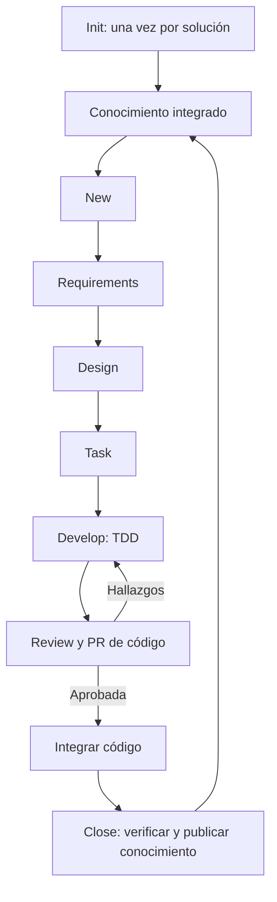

# 🧭 Super SDD: plan de una plataforma de desarrollo asistido por IA

> 📝 **Estado:** propuesta de diseño · 🎨 **Perfil visual:** `markdown-mermaid@1.0.0`

**Raíz del proyecto:** `F:\Proyectos\superharness`

**Versión:** 0.1 · **Fecha:** 16 de octubre de 2026 · **Estado:** propuesta para implementar.

El objetivo es construir una aplicación en **Go** que convierta una especificación local o un ticket de Jira en una entrega trazable en GitHub. Usará **Specification-Driven Development (SDD)** para decidir qué construir, **TDD** para implementar y un grafo de código para recuperar contexto relevante. Codex será el primer ejecutor y Claude Code un segundo adaptador intercambiable.

La recomendación central es que **Go controle el proceso y los modelos produzcan propuestas dentro de contratos verificables**. Los prompts no deben decidir si una fase está terminada, si se puede modificar código ni si una PR está lista. Esas decisiones corresponden a reglas, evidencias y validadores del orquestador.

Este directorio contiene el plan, no una aplicación funcional. Los comandos, esquemas y configuraciones que aparecen son contratos propuestos. No se han instalado skills, generado un grafo, ejecutado compilaciones ni conectado cuentas. La inspección de `F:\Proyectos\_Develapi` fue de lectura; no se ha modificado ese proyecto.

## 📁 Separación obligatoria de repositorios

El repositorio de la aplicación Superharness es `F:\Proyectos\superharness`. El conocimiento de cada proyecto analizado se guarda en **otro repositorio Git**, externo al código. Para DevelApi, la ubicación propuesta es `F:\Proyectos\_Develapi\develapi-superharness`: contendrá análisis inicial, SPEC por carpetas, documentación vigente, ADR, trazabilidad y manifiestos. No se generan carpetas de Superharness ni SPEC dentro de Gateway, Library, Core u otros repositorios analizados.

`/super-init` inicializa una sola vez cada solución en ese repositorio de conocimiento. `/super-close` lo mantiene y `/super-new` lo consulta. El código y sus tests permanecen en sus repositorios originales. El [contrato de separación](11-repositorio-de-conocimiento.md) define rutas, permisos y sincronización. Este plan describe el repositorio complementario; todavía no lo crea ni analiza DevelApi de nuevo.

La nomenclatura es genérica: `<proyecto>-superharness`; `develapi-superharness` es solo un ejemplo. Sus carpetas gestionadas de primer nivel serán `.baseline`, `.specs`, `.project`, `.inbox` y `.super`. Las subcarpetas conservan nombres normales, como `.specs/SPEC-001/tasks/`. El README de entrada permanece en la raíz.

## ⚙️ Estándar visual de todos los Markdown

Todos los `.md` generados por el flujo aplicarán **`markdown-mermaid@1.0.0`**: iconos semánticos, títulos jerárquicos, metadatos legibles, tablas/checklists cuando correspondan y diagramas Mermaid para explicar relaciones relevantes. Es una obligación del renderizador de todas las fases, incluida cada tarea, ADR, handoff, informe e índice. La necesidad del gráfico depende del contenido; no se añaden diagramas decorativos a una nota trivial. Ver [estándar visual completo](12-estandar-visual-markdown.md).

## 🧭 Guía de lectura

| Documento | Qué resuelve |
|---|---|
| [01 — Visión y decisiones](01-vision-y-decisiones.md) | Qué construir, qué significa SDD y cómo lograr consistencia |
| [02 — Comandos y ciclo](02-comandos-y-ciclo.md) | Entradas, salidas, permisos y controles de los ocho comandos |
| [03 — Arquitectura Go y estado](03-arquitectura-go-y-estado.md) | Componentes, almacenamiento, contexto limpio, reanudación y concurrencia |
| [04 — Grafo y contexto](04-grafo-y-contexto.md) | CodeGraph, búsqueda, actualización, límites y medición de tokens |
| [05 — Estándar .NET DevelApi](05-estandar-dotnet-develapi.md) | Estructura, nombres, formato, comentarios y controles basados en el código leído |
| [06 — Codex, Claude, Jira y GitHub](06-integraciones.md) | Adaptadores, capacidades, autenticación y operaciones remotas |
| [07 — Contratos y plantillas](07-contratos-y-plantillas.md) | Estructura de carpetas, documentos, Gherkin, tareas, evidencias y prompts |
| [08 — Implementación y validación](08-roadmap-y-validacion.md) | Fases, backlog inicial, pruebas de la herramienta y criterios de entrega |
| [09 — Ejemplo de una SPEC](09-ejemplo-spec.md) | Recorrido completo de una mejora hipotética de Library |
| [10 — Evidencias y fuentes](10-evidencias-y-fuentes.md) | Alcance de inspección, referencias locales, fuentes oficiales y decisiones pendientes |
| [11 — Repositorio de conocimiento](11-repositorio-de-conocimiento.md) | Separación física del código, estructura externa y cierre entre repositorios |
| [🎨 12 — Estándar visual Markdown](12-estandar-visual-markdown.md) | Iconos, formato, Mermaid y validación para todos los `.md` del flujo |

## 🔄 Flujo solicitado

El cierre actualiza el conocimiento externo; la siguiente feature empieza en new sin repetir init.

**Inicialización única por solución:** las siguientes features empiezan directamente en `/super-new`. Cada `/super-close` actualiza documentación, decisiones, capacidades y grafo para que la próxima SPEC utilice ese conocimiento. No se repite init por SPEC, usuario, sesión, rama ni clon. Una invocación accidental informa de que la solución ya está inicializada y no regenera su base.

Cada flecha representa artefactos persistidos y validados. Cada comando crea una sesión de IA nueva. Una fase bloqueada conserva el progreso sin permitir avanzar como si estuviera terminada.

Se mantendrá `super-requeriments` como alias por compatibilidad con el nombre solicitado; el nombre canónico será `super requirements`. La CLI también expondrá `super init`, `super new`, `super design`, `super task`, `super develop`, `super review` y `super close`.

## 🏗️ Decisiones recomendadas

1. Empezar por una CLI local en Go. Añadir una consola `super shell` para que los `/super-*` funcionen de forma uniforme, independientemente del proveedor.
2. Ejecutar cada fase en un proceso de Codex o Claude nuevo; reconstruir el contexto desde archivos y evidencias. La conversación no será el almacenamiento.
3. Guardar las especificaciones y decisiones en Markdown versionado, contratos estructurados en JSON y el diario de ejecución en SQLite local.
4. Usar CodeGraphContext como candidato inicial, sujeto a una prueba con C#, `.slnx`, dependencias privadas y la DI real del proyecto. Mantener una interfaz que permita sustituirlo.
5. Derivar un perfil .NET de DevelApi y fijarlo por versión. Diferenciar las convenciones existentes de las mejoras propuestas.
6. Crear la PR hacia `develop` en review, con revisión ligada a su commit exacto. Una PR creada no significa una entrega aprobada o integrada.
7. Mantener código y conocimiento en repositorios distintos. Close verifica el merge del código y publica la documentación vigente en el repositorio complementario, enlazando ambos commits; una preparación previa es opcional.
8. Medir similitud por cobertura de requisitos, estructura, reglas y comportamiento. No prometer texto ni código idéntico entre modelos.

## 🎯 Por dónde empezar

La primera entrega debe demostrar el recorrido `init → new → requirements → design → task` sobre una SPEC local y un repositorio. Debe sobrevivir a cerrar el proceso y continuar con otro usuario o proveedor. Después se incorporan TDD, review, Jira, GitHub y close. La aplicación debe gestionar su propio desarrollo con estas mismas especificaciones, una vez exista el motor mínimo.

Quedan configurables, sin bloquear este plan: producto exacto al que llamas «codegraph», Jira Cloud o Data Center, repositorio piloto, credenciales, modelos disponibles, política de revisión humana y correspondencia entre estados de Jira y estados del flujo. Los valores recomendados y sus límites están documentados.
